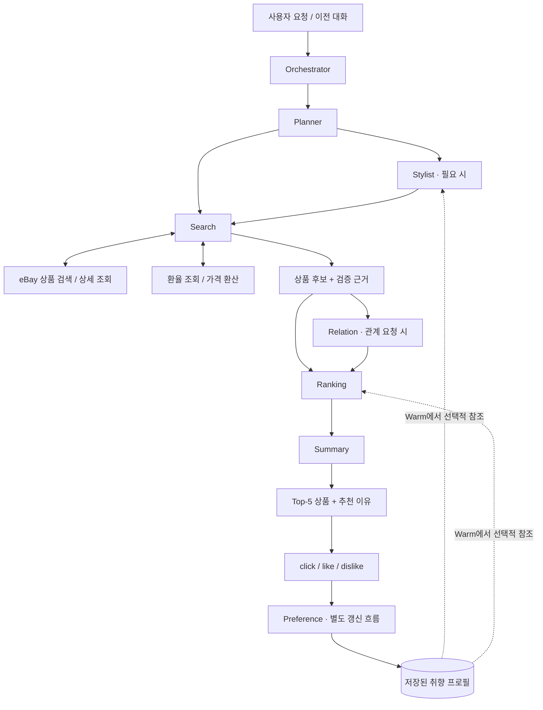
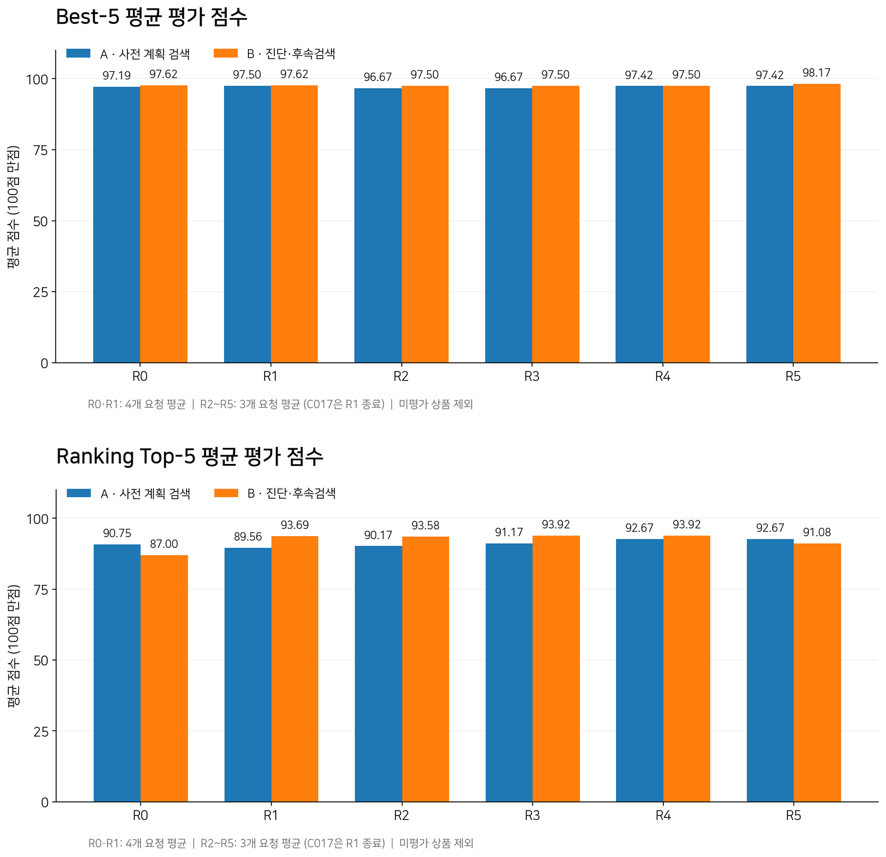
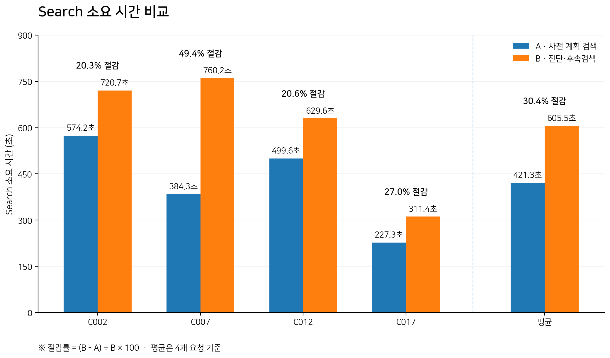
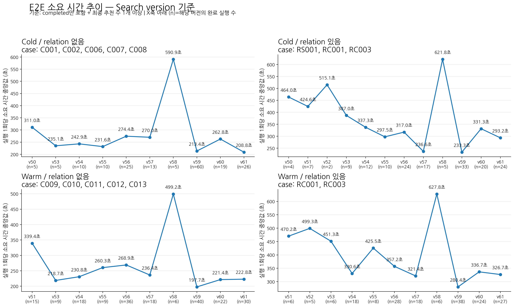
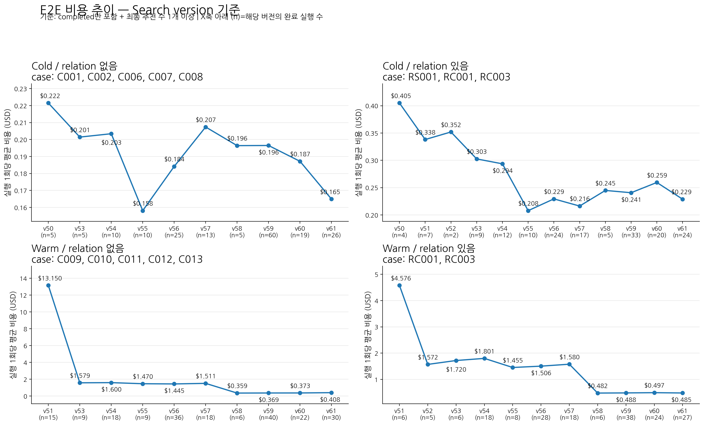
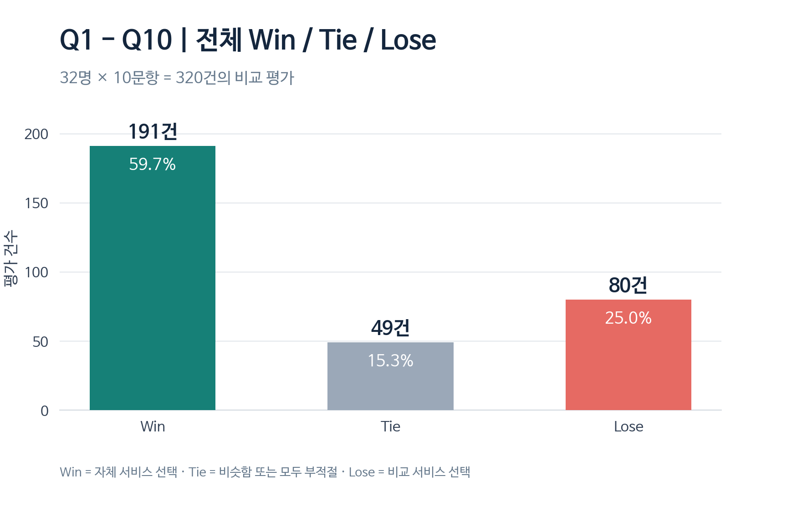
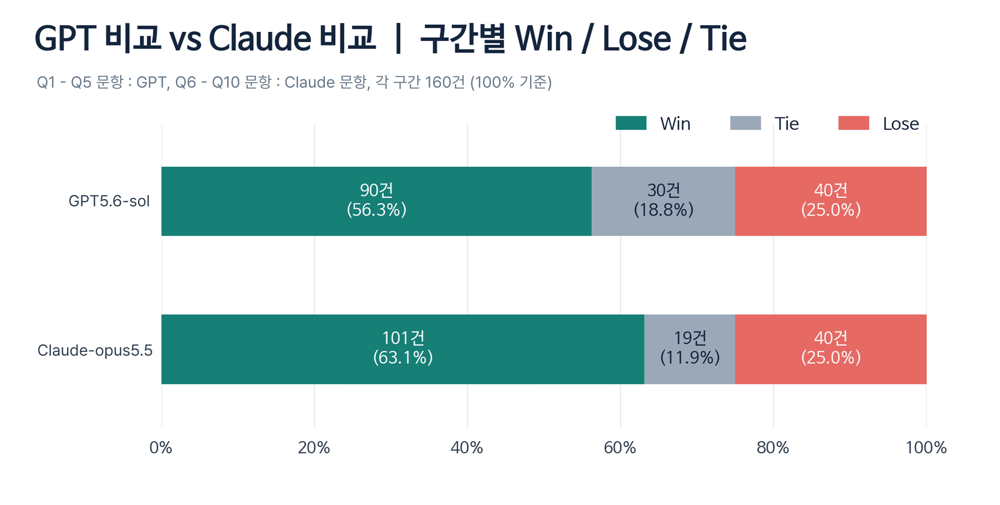

# 🧥 대화형 패션 아이템 추천 서비스

**자연어로 원하는 옷을 설명하면, 실제 상품을 탐색하고 추천 근거까지 제공하는 LLM 기반 멀티 에이전트 패션 추천 시스템**

> “배가 많이 드러나지 않는 검정 크롭티”, “너무 후줄근해 보이지 않는 편한 바지”처럼 키워드와 필터만으로 표현하기 어려운 요구를 검색 가능한 조건으로 해석하고, 실제 상품 추천으로 연결합니다.

- **프로젝트명:** `fashion_recommendation_v2`
- **기간:** 2026.09.14 ~ 2026.10.21
- **형태:** 개인 프로젝트 · 기획, 시스템 설계, 개발, 평가 및 개선 전 과정 수행
- **상품 데이터:** eBay API
- **Prototype** : [서비스 체험하기](https://43.202.6.110/)
- **기획안** : [Notion에서 확인하기](https://app.notion.com/p/3f7856fc07af80f09039d5242dbb89b2?source=copy_link)

## Key Results

| 평가 항목 | 결과 |
| --- | --- |
| **E2E 실행 완료율** | **100%** (72/72건) |
| **추천 결과 확보** | **72건 모두 Top-5 추천 완료** |
| **E2E 응답 시간** | 중앙값 **231.88초** / 평균 **248.63초** |
| **완료 건 평균 추정 비용** | **$0.3084 / 요청** |
| **사람 평가 Win 비율** | **59.7%** (191/320건) |
| **사람 평가 Lose 비율** | **25.0%** (80/320건) |
| **Tie 제외 승률** | **70.5%** |

> E2E 결과는 고정된 최종 버전의 72회 실행 기준이며, 사람 평가는 32명이 10개 요청에 대해 수행한 320건의 비교 판단 기준입니다. 평균 비용은 **기록된 호출의 추정치**로, 비용이 확인되지 않은 호출이 존재합니다.

## 1. Problem — 왜 만들었는가?

기존 패션 검색은 상품명, 브랜드, 카테고리, 색상 등의 **명시적인 키워드와 필터**를 중심으로 동작합니다. 하지만 실제 사용자는 소재감, 핏의 정도, 착용 맥락, 분위기, 제외 조건 등을 함께 고려합니다.

예를 들어 다음 요청은 하나의 검색어로 표현하거나 검색 결과에서 자동으로 판별하기 어렵습니다.

| 자연어 요청 | 검색·평가에서 해석해야 할 요소 |
| --- | --- |
| “배가 많이 드러나지 않는 검정 크롭티” | 티셔츠, 검정색, 복부 노출이 적은 기장 |
| “너무 후줄근해 보이지 않는 편한 바지” | 편안한 착용감과 단정한 인상의 균형 |
| “흰 티셔츠에 어울리는 아우터” | 추천 대상과 기준 상품 간 조합 적합성 |
| “3번 추천과 비슷한 원피스” | 이전 추천 상품의 특징과 유사성 |

범용 AI는 이러한 문장을 이해할 수 있지만, **실제 구매 가능한 상품을 일관된 형식과 품질로 제시하는 일**은 별도의 탐색·검증 과정이 필요했습니다.

이 프로젝트의 목표는 자연어 이해에서 끝나지 않고 **조건 해석 → 실제 상품 탐색 → 근거 기반 후보 평가 → 추천 결과 설명**까지 연결하여 사용자의 반복 검색과 개별 상품 검토 부담을 줄이는 것입니다.

## 2. Features — 제공하는 경험

| 기능 | 설명 |
| --- | --- |
| **자연어 조건 기반 상품 탐색** | 스타일·분위기·착용 상황 등 모호한 표현을 상품 조건으로 구체화하고 검색·후보 평가에 반영 |
| **Cold / Warm 개인화 추천** | 저장 취향이 없어도 추천하며, 취향이 있으면 현재 요청과 관련된 정보만 선택적으로 반영 |
| **관계형 추천** | 기준 상품과 **비슷한 상품(Similarity)** 또는 **함께 입기 좋은 상품(Compatibility)** 추천 |
| **후속 요청** | 이전 대화와 추천 결과를 참조해 색상·핏·가격 등의 조건을 수정하거나 특정 상품을 기준으로 재탐색 |
| **설명 가능한 Top-5** | 상품 이미지·가격·링크와 함께 추천 이유 및 확인하지 못한 조건을 안내 |

**추천 대화 예시**

```text
사용자: 배가 많이 드러나지 않는 크롭티 찾아줘. 검정색으로.
서비스: 요청 조건을 해석해 상품 후보를 탐색하고, 적합도에 따라 Top-5를 추천

사용자: 이 중 3번과 비슷한 제품으로 조금 더 저렴하게 찾아줘.
서비스: 이전 3번 상품을 기준으로 유사 특징을 참고하고, 가격 조건을 반영해 재탐색
```

*위 대화는 기능을 설명하기 위한 예시이며 실제 실행 로그를 그대로 옮긴 것은 아닙니다.*

## 3. Architecture — 멀티 에이전트 구조

**Orchestrator**가 현재 요청과 이전 대화에서 목표를 파악하고, **Planner**가 필요한 에이전트와 실행 순서를 정합니다. 에이전트별 책임을 분리하되, 앞 단계에서 확보한 상품 정보·이미지 관찰 결과를 다음 단계에서 재사용하도록 구성했습니다.



| 구성 요소 | 담당 역할 |
| --- | --- |
| **Orchestrator / Planner** | 요청 목표·추천 개수·관계 의도·이전 대화 확인, 실행 단계 및 의존관계 결정 |
| **Stylist** | 모호한 표현을 구체적인 조건으로 해석하고 미해결 조건 분리 |
| **Search** | 검색어·필터 구성, eBay 검색, 후보 수집·중복 제거·조건 검증 및 상품 근거 저장 |
| **Relation** | 기준 상품과 후보의 유사성 또는 코디 조합 적합성 평가 |
| **Ranking** | 요청 적합도·이미지 품질·취향·관계 점수를 시나리오별로 결합해 최종 선정 |
| **Summary** | Top-5 상품과 추천 이유 생성, 미충족 조건과 불확실성 안내 |
| **Preference** | 클릭·좋아요·싫어요의 기록과 당시 상품 근거를 기반으로 취향 프로필 생성·갱신 |

**실행 설계 원칙**

- **현재 요청 우선:** 프로필이 있어도 사용자가 명시한 조건을 취향보다 우선합니다.
- **근거 재사용:** Search가 확보한 메타데이터·이미지 관찰 결과를 Relation, Ranking, Summary에서 재사용하여 중복 분석을 줄입니다.
- **선택적 병렬화:** 의존성이 없는 작업만 병렬로 처리하며 API 호출 한도와 자원 제약을 고려합니다.
- **역할별 모델 선택:** 모든 에이전트에 동일한 모델을 사용하지 않고 판단 난이도·품질·시간·비용에 따라 배치합니다.
- **추천과 프로필 갱신 분리:** 사용자 행동 기반 Preference 갱신은 추천 응답 흐름과 별도로 수행합니다.

## 4. Core Design — 핵심 설계

### 4-1. Search: 자연어 조건을 검색과 평가에 연결

사용자 요청을 단순 검색어 하나로 축약하지 않고, 각 조건에 **역할(role), 출처(source), 강도(kind), 검색 사용 여부, 평가 담당(owner)**을 부여합니다.

**예시: “배가 많이 드러나지 않는 크롭티 찾아줘. 검정색으로.”**

| 추출 조건 | 출처 | 강도 | 활용 |
| --- | --- | --- | --- |
| `tee shirt` | User | **Hard** | 상품 종류 검색 및 후보 통과 여부 판단 |
| `black` | User | **Hard** | 색상 검색 및 후보 통과 여부 판단 |
| `semi-cropped` | Stylist | **Soft** | 검색 방향 보완 및 Ranking 적합도 평가 |

생성 가능한 검색어는 `black T-shirt`, `black semi-cropped T-shirt` 등입니다. **검정색 티셔츠**는 후보 선정에 필요한 필수 조건이지만, **semi-cropped**는 자연어 해석으로 도출한 선호 조건이므로 미충족만으로 즉시 제외하지 않습니다.

이 구조는 다음 문제를 방지하도록 설계했습니다.

- 모호한 표현을 임의로 **필수 조건**으로 확정하여 후보가 과도하게 줄어드는 문제
- 유사 상품 요청에서 기준 상품의 특징을 추천 대상의 **절대 조건**으로 복사하는 문제
- Search가 확인할 조건과 Relation·Ranking이 판단할 조건이 섞이는 문제

### 4-2. Ranking: 시나리오별 점수 체계

동일한 가중치를 모든 요청에 사용하지 않고 **일반 추천 / 개인화 추천 / 관계형 추천**에 따라 반영할 신호를 달리합니다.

| 점수 | 의미 |
| --- | --- |
| **R** | 현재 요청에 대한 적합도 |
| **Q** | 상품 이미지의 품질·판단 유용성 |
| **T** | 상품 검색 순위 신호 |
| **P** | 저장된 취향과 후보의 적합도 |
| **Relation** | 기준 상품과의 유사성 또는 조합 적합성 |

대표 정책은 다음과 같습니다.

| 시나리오 | 적용 조건 | 최종 점수 예시 |
| --- | --- | --- |
| 일반 **Cold** | R 활성 | `0.40R + 0.50Q + 0.10T` |
| 일반 **Warm** | R 및 정상적인 P 점수 활성 | `0.34375R + 0.1375Q + 0.06875T + 0.45P` |
| **Similarity** | R 비활성, 관계 점수 사용 | `0.95Relation + 0.05T` |
| **Compatibility** | Cold, R 활성 | `0.4125R + 0.2625Q + 0.075T + 0.25Relation` |

*위 식은 대표적인 정책입니다. 실제로는 R·P·Relation 점수의 계산 가능 여부와 평가 근거 상태에 따라 가중치 및 후보 처리 정책이 달라집니다.*

최종 선정은 단순 점수 정렬만이 아니라 **필수 조건 위반 후보 제외, 평가 상태 구분, 결과 다양성**도 고려합니다. Ranking은 이미 확보한 이미지 근거를 재사용하고 불필요한 재분석을 피합니다.

### 4-3. Preference: 행동의 근거와 불확실성을 함께 저장

개인화는 `click / like / dislike`를 단순히 특정 색상이나 디자인에 대한 선호로 치환하지 않는 데 중점을 두었습니다.

```text
상품 클릭 / 좋아요 / 싫어요
    ↓
행동 당시 상품 스냅샷 및 추천 맥락 저장
    ↓
Preference Agent가 지지·반대 근거를 함께 해석
    ↓
적용 범위 · 중요도 · 확신도 · 불확실성 검증 및 저장
    ↓
이후 세션의 Stylist / Ranking에서 필요한 경우에만 활용
```

- **적용 범위(scope):** 특정 카테고리에만 유효한 취향과 여러 카테고리에 공통인 취향을 구분합니다.
- **중요도(importance) / 확신도(confidence):** 추천에서 고려할 비중과 취향 해석의 신뢰도를 별도 관리합니다.
- **지지·반대 근거:** 같은 특징에 대해 상반된 반응이 있으면 이를 함께 기록합니다.
- **Cold / Warm:** 프로필이 없는 경우 현재 요청 중심으로 추천하고, Warm에서는 관련 취향만 조건 해석·후보 선정에 반영합니다.
- **Similarity 예외:** 특정 상품과의 유사성이 핵심인 요청은 해당 요청 단위에서 개인화를 제외합니다.

별도의 가입·로그인 없이 **쿠키 기반 식별자**로 행동 이력과 프로필을 연결하도록 구현했습니다.

## 5. Experiments — 설계 효과 검증

### 5-1. Search: 사전 계획 검색 vs 진단·후속 검색

**질문:** 검색 결과를 매번 진단하고 검색어를 수정하면, 추가 실행 시간만큼 추천 품질이 개선되는가?

동일한 사용자 요청 4개에서 **사전 계획 검색(A)**과 **진단·후속 검색(B)**을 비교했습니다. 방식별 검색 쿼리 총수는 38개로 맞추고, 수집된 상품은 별도 LLM Judge의 적합도 평가와 고정 Ranking을 통해 비교했습니다.

| 지표 | 사전 계획 검색 A | 진단·후속 검색 B | 해석 |
| --- | ---: | ---: | --- |
| **평균 Search 시간** | **421.3초** | 605.5초 | A가 평균 **30.4%** 단축 |
| **요청당 평균 시간 차이** | — | — | A가 **184.1초** 절약 |
| **Best-5 품질** | — | B가 **+0.51점** | 품질 비교 가능한 3개 요청의 차이가 작음 |
| **Ranking Top-5 품질** | — | B가 **+1.03점** | B가 일관되게 우세하지는 않음 |

> **결정:** 일부 품질 개선은 있었지만 모든 요청에서 일관되지 않았고, A가 비교한 4개 요청 모두에서 더 빨랐습니다. 따라서 **사전 계획 검색을 기본 검색 전략으로 유지**했습니다.





### 5-2. Ranking: 가중치 최적화

동일한 후보 상품과 Judge·사람 평가 점수를 고정한 뒤, **가중치만 변경**해 Top-5 평균 평가 점수(100점 만점)와 **NDCG@5**를 비교했습니다.

| 조건 | 검증 대상 | 요청 수 | 가중치 조합 수 | 최종 정책 |
| --- | --- | ---: | ---: | --- |
| **A** | 요청 적합도(R) / 이미지 품질(Q) / 검색 신호(T) | 10개 | 14개 | **A9** |
| **B** | 개인 취향(P) 반영 정도 | 5개 | 13개 | **B11** |
| **C** | 유사성(Relation) 반영 정도 | 5개 | 13개 | **C12** |

| 조건 | Top-5 평균 점수 | NDCG@5 | 핵심 변화 |
| --- | ---: | ---: | --- |
| **A: A0 → A9** | 91.70 → **92.78** (**+1.08점**) | 0.9403 → **0.9466** | R 0.55 → 0.40, Q 0.35 → 0.50 |
| **B: B0 → B11** | 84.00 → **85.35** (**+1.35점**) | 0.9328 → **0.9411** | P 0.20 → **0.45** |
| **C: C0 → C12** | 79.20 → **81.75** (**+2.55점**) | 0.9172 → **0.9413** | Relation 0.55 → **0.95** |

**실험에서 얻은 판단**

- **A:** 요청 적합도와 이미지 품질의 균형을 조정하고 검색 신호를 일부 유지한 A9가 가장 높은 평균 NDCG@5를 기록했습니다.
- **B:** 취향 가중치를 높이면 품질이 개선되는 구간이 있었지만, 무조건 높일수록 계속 좋아지지는 않았습니다. 최종적으로 **B11(P=0.45)**을 적용했습니다.
- **C:** 유사성 요청에서는 Relation의 비중을 크게 두되 검색 신호를 소량 유지한 **C12**를 채택했습니다.


## 6. Evaluation — 최종 시스템 평가

### 6-1. E2E 성능 및 안정성

**2026년 10월 18일**, 아래 구성의 버전을 고정해 일반·관계형 추천을 Cold/Warm 시나리오로 나누어 반복 평가했습니다.

| Orchestrator | Planner | Stylist | Search | Relation | Ranking | Summary | Preference |
| --- | --- | --- | --- | --- | --- | --- | --- |
| v12 | v4 | v8 | v61 | v9 | v17 | v13 | v4 |

| 목표 및 지표 | 최종 결과 | 판단 |
| --- | --- | --- |
| **실행 완료** | **72/72건 완료**, 실패 0건 | 달성 |
| **추천 0건 방지** | **72건 모두 추천 상품 5개 확보** | 달성 |
| **응답 시간 420초 미만** | 평균 **248.63초**, 중앙값 **231.88초** | **72건 중 3건 초과** |
| **평균 추정 비용 $1 이하** | **$0.3084 / 완료 요청** | 기록된 추정치 기준 달성 |

또한 **2026.10.10~2026.10.21**의 버전별 실행 로그를 기반으로 Search 버전에 따른 응답 시간과 추정 비용을 추적했습니다. 시간은 **실행당 중앙값**, 비용은 **실행당 평균**으로 집계했으며, `completed` 상태이며 최종 추천 상품이 1개 이상인 실행만 포함하고, 버전별 실행 수(`n`)를 함께 표시했습니다.





### 6-2. 사람 평가: GPT / Claude 대비 추천 품질 비교

자체 추천 결과가 사용자의 요청 조건을 얼마나 잘 반영하는지 확인하기 위해 동일한 요청에 대한 **자체 서비스 vs 범용 AI** 추천 결과를 A/B 형태로 제시했습니다.

- **참여자:** 32명
- **사용자 요청:** 10개
- **총 비교 판단:** 320건
- **비교 대상:** GPT, Claude
- **질문:** 어느 쪽 추천 결과가 사용자 요청을 더 잘 반영했는가?
- **평가 조건:** 추천 상품의 **개수는 판단 기준에서 제외**

| 평가 | 응답 수 | 비율 | 의미 |
| --- | ---: | ---: | --- |
| **Win** | **191건** | **59.7%** | 자체 서비스 선택 |
| **Tie** | 49건 | 15.3% | 비슷하거나 둘 다 적절하지 않음 |
| **Lose** | 80건 | 25.0% | 비교 AI 선택 |

**Win은 Lose보다 34.7%p 높았고, Tie를 제외하면 70.5%의 승률**을 기록했습니다. 이 결과는 평가에 포함된 10개 요청과 32명의 판단에 대한 것이며, 모든 패션 상품 탐색 상황에 대한 일반화된 성능을 의미하지는 않습니다.





## 7. Limitations & Next Steps

현재 결과는 **프로토타입의 가능성을 검증한 결과**이며, 운영 환경에서의 성능을 보장하지는 않습니다.

1. **응답 지연:** 최종 72회 실행 중 3회는 목표인 420초를 초과했습니다. 특히 개인화 요청에서 추가적인 최적화가 필요합니다.
2. **비용 계측:** 완료 건 평균 추정 비용은 낮았지만, 비용 미상 호출이 있어 전체 비용을 완전히 계측한 값은 아닙니다.
3. **개인화 평가 범위:** 정해진 인터랙션과 A·B·C 프로필에 기반한 실험이므로 실제 사용자의 다양한 취향을 대표하지 못할 수 있습니다.
4. **평가의 한계:** Top-5 점수와 NDCG만으로 사용자 만족도, 설명의 사실성, 구매 의사결정에 대한 도움을 모두 측정할 수 없습니다.

**후속 개선 방향**은 실패·장시간 실행 케이스 분석, Warm 요청의 비용 절감, 실제 사용자 행동 데이터 기반 개인화 검증, 추천 이유의 사실성 평가입니다.
