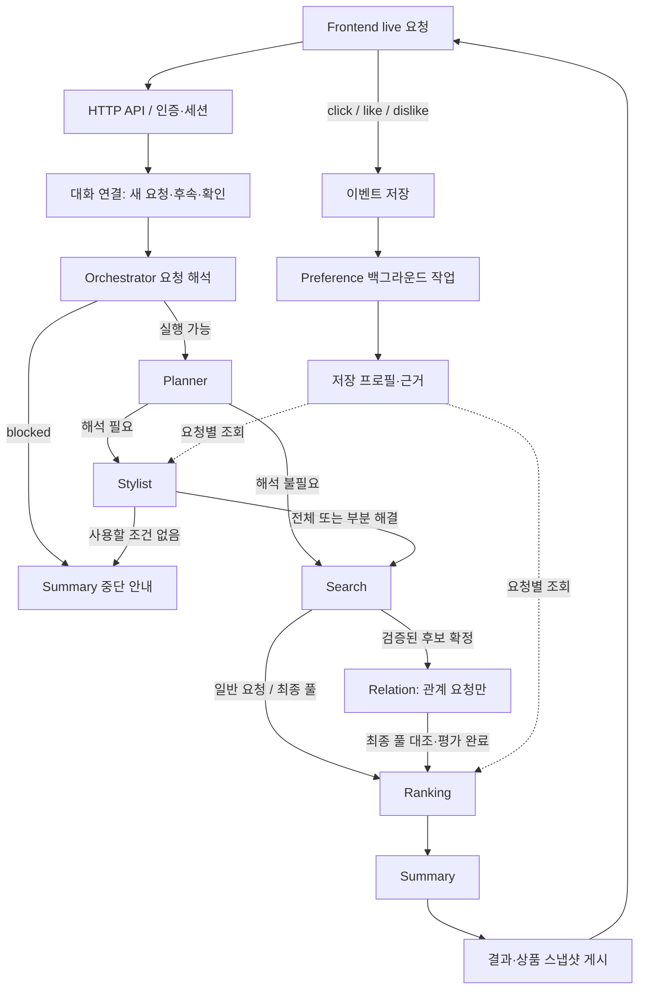

# 서비스 전체 구조

이 문서는 공개본의 현재 서비스 연결을 설명한다. 버전 선택의 기준은 [서비스 팩토리](../src/fashion_recommendation_v2/server/recommendation_factory.py)와 [서버 진입점](../scripts/run_preference_server.py)이다. 코드의 기본 생성자만 호출하면 서비스와 다른 설정이 선택될 수 있으므로 재현에는 이 진입점을 사용한다.

## 구성과 책임

| 구성 | 서비스 버전 | 역할 | 상세 문서 |
| --- | --- | --- | --- |
| Orchestrator | v10 | 요청 해석, 상태·실행·인계 검증 | [orchestrator.md](orchestrator.md) |
| Planner | v4 | 주어진 상태를 실행 계획으로 구성 | [planner.md](planner.md) |
| Stylist | v6 | 미해결 표현을 검색 가능한 soft 조건으로 해석 | [stylist.md](stylist.md) |
| Search | v56 | 검색 조건·계획, 조회, 상품 평가, 후보 풀 | [search.md](search.md) |
| Relation | v8 | 기준과 후보의 similarity/compatibility 평가 | [relation.md](relation.md) |
| Ranking | v15 | 추천 자격·점수·개인화·최종 선정 | [ranking.md](ranking.md) |
| Summary | v11 | 확정 결과를 사용자 응답으로 설명 | [summary.md](summary.md) |
| Preference | v4 | 행동과 저장된 상품 근거를 취향 프로필로 해석 | [preference.md](preference.md) |

문서의 버전은 서비스 실행 버전이다. 현재 출력에 사용되는 `personalization_v12`, `item_statuses_v7`, `score_breakdowns_v5` 같은 필드는 현재도 유효한 저장 계약 이름이다. 이 이름만 보고 실행 버전을 판단하지 않는다.

## 요청에서 응답까지



Relation은 Search 종료 뒤에만 시작하는 단계가 아니다. 관계 요청에서는 검증·편입이 완료된 후보를 순차적으로 전달받아 Search와 겹쳐 실행한다. Ranking은 최종 후보 풀에 대한 Relation의 대조와 평가 종료를 기다린다. Planner의 논리적 의존 순서와 실제 작업의 시간상 중첩을 구분해야 한다.

Preference 갱신은 추천 계획 바깥의 작업이다. 추천 중 매번 새 프로필을 생성하지 않으며, Stylist와 Ranking은 인증된 사용자에 대한 저장 프로필을 조회한다.

## 코드 지도

| 경로 | 책임 |
| --- | --- |
| [server/recommendation_service.py](../src/fashion_recommendation_v2/server/recommendation_service.py) | 대화·세션·요청과 저장소를 연결 |
| [server/recommendation_runtime.py](../src/fashion_recommendation_v2/server/recommendation_runtime.py) | 추천 작업 실행·수명 관리 |
| [agents/](../src/fashion_recommendation_v2/agents/) | 에이전트 진입점과 실행기 |
| [llm/openai_adapter.py](../src/fashion_recommendation_v2/llm/openai_adapter.py) | 구조화 LLM 호출, 모델별 설정, 응답·스트림 처리 |
| [prompts/](../src/fashion_recommendation_v2/prompts/) | 역할별 모델 지시 |
| [schemas/](../src/fashion_recommendation_v2/schemas/) | 입출력 타입과 검증 계약 |
| [storage/preference.py](../src/fashion_recommendation_v2/storage/preference.py) | 사용자·세션·이벤트·프로필·작업의 SQLite 저장 |
| [validation_reuse.py](../src/fashion_recommendation_v2/validation_reuse.py) | 동일 요청·동일 스냅샷의 성공 검증 재사용 |
| [module_compat.py](../src/fashion_recommendation_v2/module_compat.py) | 계약 레지스트리의 모듈 이름과 통합된 역할 코드 연결 |

## 단계 사이의 데이터 계약

1. Orchestrator가 원문, 의미 단위, 미해결 상태, 관계 의도를 보존한다.
2. Planner가 입력 참조와 의존성을 갖는 `ExecutionPlan`을 반환한다.
3. Stylist의 검증된 해결 부분과 명확한 사용자 조건만 Search 입력에 반영한다. 제외된 조건은 Summary 안내용으로 따로 보존한다.
4. Search가 `CandidateSet`에 요구사항, 조회 신호, 상품별 원근거·평가, 실행 기록을 함께 반환한다.
5. Relation이 동일 후보·기준 스냅샷에 결합된 `ralationRatio`를 반환한다. 필드의 철자는 실제 코드 계약을 따른다.
6. Ranking이 `FinalRanking`에 최종 순위, 제외 사유, 점수 구성과 취향 적용 여부를 남긴다.
7. Summary가 순위를 유지한 설명을 만들고 코드는 원본 상품의 제목·가격·URL을 응답에 붙인다.

모델 응답, 코드 검증, 코드가 계산하거나 ID를 연결한 결과는 분리한다. 검증 실패 원응답을 고쳐서 성공한 모델 응답처럼 저장하지 않는다.

## 모드와 취향 반영

| 요청 | Stylist | Ranking | Relation |
| --- | --- | --- | --- |
| Cold 일반/compatibility | 취향 조회 없음 | 취향 점수 없음 | compatibility일 때 실행 |
| Warm 일반/compatibility | 호출되는 경우 저장 취향 활용 가능 | 저장 프로필로 후보별 취향 판단 | compatibility일 때 실행 |
| Similarity | 유효 실행 모드 Cold | 유효 실행 모드 Cold | 기준 상품과 유사성 평가 |

Similarity는 [personalization_policy.py](../src/fashion_recommendation_v2/personalization_policy.py)가 단계 입력의 모드를 전환한다. 원래 요청의 `personalization_mode`를 수정하지 않는다. 프로필 없음, 조회 실패, 근거 부족, 의미적 미적용은 서로 다른 상태다. `user_state` 등 다른 내부 상태를 개인화 모드와 동일한 필드로 취급하지 않는다.

## 모델과 실행 제한을 읽는 법

Planner는 `gpt-6-luna`/low/4,096 출력 토큰, Stylist 해석·조회와 Relation·Ranking 취향 평가·Summary는 해당 서비스 정책의 `gpt-6-luna`를 사용한다. Search는 작업별 모델 라우팅을 적용하므로 [Search 문서](search.md)를 따른다. 서버의 공용 `--model` 기본값은 `gpt-5.6-sol`이며 Preference 처리 등에 전달된다. 단계별 명시 모델 설정이 우선하는 경로가 있으므로 `--model` 하나가 모든 호출 모델을 바꾸는 것으로 해석하지 않는다.

후보 목표, 조회량, 모델 호출 수, 동시 호출 수, 호출별 timeout은 서로 다른 제한이다. Search의 420초는 전체 추천의 완료 제한이 아니다. 실행 비용·시간은 실제 조회 상품 수와 실패·교정 횟수에 따라 달라진다.

## 로컬 실행과 합성 예제

공개본 루트에서 [README 설치 절차](../README.md)를 완료하고, 키는 로컬 `.env`에만 설정한다.

```sh
PYTHONPATH=src python scripts/init_preference_db.py
PYTHONPATH=src python scripts/run_preference_server.py --recommendations --origin http://127.0.0.1:5173
```

별도 터미널에서:

```sh
cd frontend
npm ci
npm run dev
```

`http://127.0.0.1:5173/?mode=live`에서 합성 요청 **검정색 반팔 티셔츠 5개 추천해줘**를 입력한다. 실행에는 외부 API와 비용이 수반된다. 로컬 포트를 바꾼 경우 프런트엔드 API 주소와 서버 허용 Origin도 맞춰야 한다.

관계 요청은 완료한 결과가 있는 같은 세션에서 **3번 상품과 비슷한 상품 5개 추천해줘**처럼 실제 반환 순위로 참조한다. 기준 상품은 서버가 소유권을 확인한 저장 결과에서 복원한다. 공개본의 고정 관계·취향 quick-start 예제 일부는 비공개 데이터가 없어 사용할 수 없으므로 직접 입력 경로를 사용한다.

## 공개본에서 검증할 수 있는 범위

```sh
PYTHONPATH=src python -m pytest -q tests
```

[서비스 연결 검사](../tests/test_service_release.py)는 현재 팩토리와 동적 의존성, [역할 통합 검사](../tests/test_role_consolidation.py)는 스키마·독립 import·합성 Ranking/Relation 사례, [프롬프트 검사](../tests/test_prompt_equivalence.py)는 고정 기준 문자열을 확인한다. 스키마 해시는 지원하는 Pydantic 버전별로 비교하며 다른 버전에서는 해당 검사만 skip한다.

전체 테스트 통과가 모든 에이전트의 실제 API 실행이나 추천 품질을 증명하지는 않는다. 공개본에는 원본의 모든 평가 스크립트·과거 결과·개인 데이터가 포함되어 있지 않다. 각 문서의 예시 JSON은 명시하지 않는 한 필드 설명용 발췌이며 전체 API payload가 아니다.

## 저장과 공개 범위

DB, 이벤트·프로필, 실행 기록에는 사용자 요청과 상품 행동이 들어갈 수 있다. 실행 산출물은 로컬 `usage/` 아래에서 관리하며 공개 예제에는 합성 데이터만 사용한다. 이 문서들은 실제 사용자 ID, API 키, 쿠키·로그인 정보, 개인 로컬 절대 경로를 포함하지 않는다. 설정 변수 이름과 코드의 인증 처리 설명은 자격 증명 값과 구분한다.
