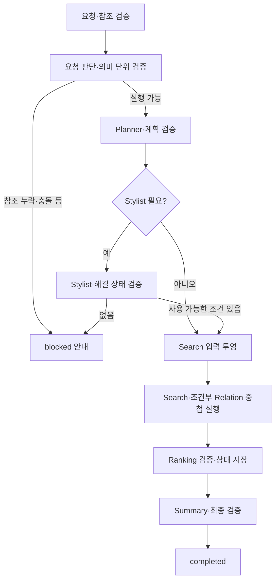

# Orchestrator — 요청 상태와 실행 흐름

현재 서비스: **v12**. [전체 구조](architecture.md) · [Planner](planner.md)

## 1. 역할과 책임

사용자 요청을 실행 가능한 의미 단위로 정리하고, 에이전트의 입력 구성·호출·결과 검증·상태 저장을 관리한다. 상품 검색 조건의 전문 해석, 상품 관계 판단, 점수 계산, 최종 설명은 각각의 담당 에이전트에 맡긴다. 대화의 새 요청·후속 요청·확인 대기는 서버의 대화 연결과 함께 처리한다.

## 2. 구조와 코드 지도

| 파일 | 역할 |
| --- | --- |
| [agents/orchestrator_brain.py](../src/fashion_recommendation_v2/agents/orchestrator_brain.py) | `OrchestratorBrain`: 요청 판단과 대화 연결 판단 |
| [agents/orchestrator_runner.py](../src/fashion_recommendation_v2/agents/orchestrator_runner.py) | `run`, `_execute`, `_call`, `_persist`: 실행·저장 |
| [agents/orchestrator_contracts.py](../src/fashion_recommendation_v2/agents/orchestrator_contracts.py) | `validate_plan`, `project_search_request` |
| [orchestrator_validation.py](../src/fashion_recommendation_v2/orchestrator_validation.py) | 의미 단위·인용 위치·상태·기준 상품 검증 |
| [schemas/orchestrator.py](../src/fashion_recommendation_v2/schemas/orchestrator.py) | 요청·상태·산출물·완료 요건 |
| [prompts/orchestrator.py](../src/fashion_recommendation_v2/prompts/orchestrator.py), [conversation.py](../src/fashion_recommendation_v2/prompts/conversation.py) | 최초 판단·교정과 대화 연결 지시 |
| [server/recommendation_service.py](../src/fashion_recommendation_v2/server/recommendation_service.py) | 인증 사용자, 세션·후속 요청, 저장 결과 복원 |

## 3. 입력과 출력

실행 진입점은 `run(PendingRequestState) → OrchestratorState`다. 서버는 인증·세션 맥락을 준비하고 실제 실행 요청과 원문을 구분한다.

| 항목 | 의미 |
| --- | --- |
| `request_id`, `session_id`, `user_id` | 요청·대화·소유자 연결. 문서 예제에 실제 값을 넣지 않음 |
| `user_query`, `original_user_query` | 실행할 요청과 보존할 원문 |
| `personalization_mode` | 현재 서비스 입력에서 명시하는 `cold`/`warm` |
| `reference_items` | 제공 가능한 저장 상품·관찰 스냅샷. 기준이 없으면 임의 생성하지 않음 |
| `goal`, `requested_count` | 최초 판단 후 확정. 추천 수 미지정은 5개 |
| `unresolved_states` | 해석이 필요한 상태와 ID, 해결 상태 |
| `execution` | 계획, 현재 단계, 상태·오류 |
| `agent_outputs` | 최초 판단, Stylist, 후보 풀, 관계, 최종 순위·응답 |

입력 검증은 첫 요청 판단 LLM 호출 전에 수행한다. 서비스의 Stylist 입력에 필요한 사용자 ID와 개인화 모드, Ranking에 필요한 개인화 모드를 누락하면 임의로 추정하지 않는다. `user_state`와 `personalization_mode`는 다른 계약이며, 취향 사용 여부는 단계의 유효 모드를 따라야 한다.

## 4. 실행 흐름



각 호출의 입력·출력은 해당 스키마로 재검증하고 저장한다. 실행 중 예외는 `failed`, 요청 자체의 실행 불가능 판단은 `blocked`로 구분한다.

## 5. 기능별 처리 방식

**대화 연결.** 새 요청에는 새 세션 맥락을 만들고, 후속 요청은 이전 완료 결과와 부모 요청을 연결한다. 새 요청인지 불확실하면 확인을 기다린다. 번호 참조는 서버가 소유권을 확인한 결과에서 실제 상품을 찾는다. 이전 요청의 조건 전체를 현재 요청에 무조건 상속하지 않는다.

**의미 단위 검증.** 모델이 원문 구간과 조건·미해결 상태·의존성을 제시한다. 코드는 인용과 위치, 빠진 문자, 중복, 상태 대응을 검사한다. 일부 독립적인 문장 종료 마침표 누락은 보수적인 규칙에 따라 경고로 남길 수 있으나 단어·숫자·부정 표현 누락까지 허용하지 않는다.

**부분 실행.** Stylist가 해결한 상태와 명확한 조건을 사용한다. 미해결 단위를 제외해도 남은 조건의 의미·부정·OR·범위를 보존할 수 있어야 한다. 원문은 저장하고 `project_search_request`가 별도 검색용 요청을 만든다. 단순 문자열 치환으로 조건을 새로 해석하지 않는다.

**관계 실행.** 관계 의도와 검증된 기준을 Search·Relation에 전달한다. Similarity에서는 기준 상품 자체를 후보에서 제외한다. 제외된 관계 구절은 다시 활성화하지 않는다. 확정 후보 콜백으로 Relation을 선행 실행하고 최종 후보 풀과 결과를 대조한다.

**Ranking 인계.** 같은 요청에서 검증된 동일 입력·출력·정책이면 성공 증명을 재사용한다. 객체 내용·타입·private/extra 상태가 바뀌면 재검증한다. 증명을 저장 JSON에 넣거나 다른 요청에 재사용하지 않는다.

## 6. LLM과 코드의 역할

LLM은 목표·추천 수·의미 단위·실행 가능성, 대화 연결을 판단한다. 코드는 계약·참조·입출력 연결, 단계 순서, 부분 투영과 상태 전이를 통제한다. Orchestrator가 의류 속성을 대신 확정하거나 점수로 후보 순위를 정하지 않는다.

## 7. 프롬프트 구성

[요청 프롬프트](../src/fashion_recommendation_v2/prompts/orchestrator.py)는 명확한 조건, 값 제한 없음, 해석이 필요한 상황 표현을 구분하고 원문 인용과 미해결 상태를 요구한다. v12는 모델이 문자 위치를 계산하지 않고 코드가 인용문의 원문 위치를 복원한다. 교정에는 이전 실패 응답과 구체적인 검증 진단을 전달하며 전체 연결을 다시 확인하게 한다. [대화 프롬프트](../src/fashion_recommendation_v2/prompts/conversation.py)는 제공된 이전 요청·추천 요약 범위에서 후속 맥락을 구성한다.

## 8. 정책과 종료 조건

- 현재 요청 판단은 `gpt-6-luna`를 명시하여 호출한다. 요청 판단은 최초 포함 최대 2회다. 새 감사 호출이나 무한 교정 루프는 없다.
- 명확한 참조 누락·명시 조건 충돌·지원하지 않는 구매처 요구는 최초 blocked 사유가 될 수 있다. 단순 프로필 부재를 최초 차단 사유로 쓰지 않는다.
- Stylist 미해결 상태가 남아도 안전하게 사용할 조건이 있으면 부분 실행한다. 사용할 조건이 없으면 blocked 안내로 끝낸다.
- 추천 수 부족은 Ranking의 `partial`/`empty` 결과와 함께 설명할 수 있다. 개수 부족과 에이전트 실행 실패는 별개다.
- 성공 완료에는 필수 산출물과 최종 응답의 정합성이 필요하다. 요청 종료 시 Relation 작업 풀과 검증 재사용 범위를 정리한다.

## 9. 실패와 복구

잘못된 계획·필수 입력 누락은 실행 실패로 남긴다. Search 전체 조회 실패와 정상 0건을 구분한다. Relation 실패 시 기록된 관계 실패를 후속 처리에 전달하되, Ranking은 관계가 필수인 후보의 실패·미평가를 제외할 수 있다. 관계 실패가 언제나 일반 추천으로 자동 복구된다는 뜻은 아니다.

Blocked 설명은 Summary가 생성하며 기본 경로 실패 후 별도 마지막 안내 시도가 가능하다. 모두 실패해도 원래 blocked 사유와 설명 생성 오류를 보존한다. 성공한 것처럼 고정 문구를 조작하지 않는다.

## 10. 실행 예제와 테스트

합성 요청 **가을용 체크 셔츠를 회사 복장 규정에 맞게 추천해줘**에서 규정이 제공되지 않았다면, 그 조건의 해결 가능성과 안전한 분리 여부에 따라 부분 실행 또는 blocked가 될 수 있다. 특정 모델 출력의 보장 예제가 아니라 분기를 확인하기 위한 입력이다.

```sh
PYTHONPATH=src python -m pytest -q tests/test_service_release.py tests/test_role_consolidation.py
```

[서비스 검사](../tests/test_service_release.py)는 현재 연결, [통합 검사](../tests/test_role_consolidation.py)는 스키마·의존성과 일부 후속 동작을 검증한다. 실제 대화 해석·부분 실행 전용 전체 회귀가 공개본에 모두 포함되지는 않는다. Live 확인은 [전체 실행 안내](architecture.md#로컬-실행과-합성-예제)를 따른다.

## 11. 설계 이유와 한계

입출력과 저장 시점마다 정합성을 확인하여 잘못된 근거·순위가 후속 단계에 전파되는 것을 막는다. 성공 검증 재사용은 이를 생략하는 캐시가 아니라 같은 스냅샷의 중복 계산을 줄이는 장치다. 자연어 의미 분리의 정확성, 실제 지연과 추천 품질은 별도 실험이 필요하다. 단계 진단 시간은 중첩 구간을 포함할 수 있어 단순 합산하지 않는다.
