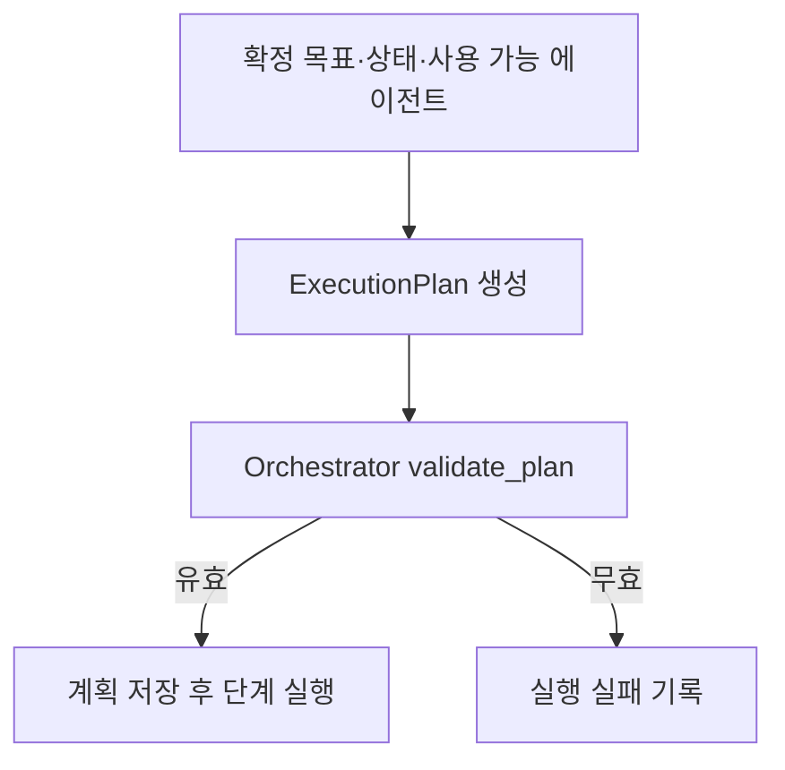

# Planner — 실행 계획 구성

현재 서비스: **v4**. [전체 구조](architecture.md) · [Orchestrator](orchestrator.md)

## 1. 역할과 책임

Planner는 Orchestrator가 확정한 목표와 미해결 상태를 실행 가능한 에이전트 순서로 바꾼다. 상품 조건을 새로 해석하거나 검색·평가하지 않는다. 미해결 상태를 새로 만들지 않고 입력으로 받은 상태 ID를 계획에 보존한다. Preference 프로필 갱신은 이 계획에 포함하지 않는다.

## 2. 구조와 코드 지도

| 파일 | 핵심 심볼·책임 |
| --- | --- |
| [agents/planner.py](../src/fashion_recommendation_v2/agents/planner.py) | `PlannerAgent.run`: 구조화 계획 생성 1회 |
| [schemas/planner.py](../src/fashion_recommendation_v2/schemas/planner.py) | `PlannerInput`, `PlanStep`, `ExecutionPlan` |
| [planner/planner_contracts.py](../src/fashion_recommendation_v2/planner/planner_contracts.py) | 서비스 버전과 조건부 필수 입력 참조 |
| [prompts/planner.py](../src/fashion_recommendation_v2/prompts/planner.py) | `PLANNER_SYSTEM_PROMPT` |
| [agents/orchestrator_contracts.py](../src/fashion_recommendation_v2/agents/orchestrator_contracts.py) | `validate_plan`: 실행 전 계획 검증 |

Planner 자체와 실행기의 책임을 나눠 읽는다. `run()`은 LLM 호출 결과를 반환하고 실제 순서·참조 검증과 실행은 Orchestrator가 수행한다.

## 3. 입력과 출력

| 입력 필드 | 의미·필수 여부 |
| --- | --- |
| `request_id`, `user_query`, `goal` | 필수. 요청 식별자, 실행 요청, 확정 목표 |
| `unresolved_states` | 기본 `[]`. `state_id`, 설명, 담당 에이전트 |
| `relation_intent` | 기본 `null`. 관계 평가 필요 여부와 기준 정보 |
| `state` | 필수. `user_state`, `product_source`, 프로필 조회 상태·완료 산출물 |
| `available_agents` | 필수. 사용할 수 있는 이름·설명·출력 스키마 |

PlannerInput에는 별도 `requested_count` 필드가 없다. Orchestrator가 `goal`에 확정 추천 수를 추가한다. `state.profile_lookup_status` 기본값은 `not_found`, `completed_outputs`는 `[]`이다.

출력 `ExecutionPlan`은 `plan_id`, `goal`, `unresolved_states`, `steps`, `created_at`을 가진다. 각 `PlanStep`의 `order`는 1 이상이고, `status` 기본값은 `pending`이다. `depends_on`은 단계 ID, `required_inputs`는 상태 경로, `expected_output`은 계약상의 산출물 이름이다.

## 4. 실행 흐름



일반 요청의 논리 순서는 Search → Ranking → Summary다. 해석할 상태가 있으면 맨 앞에 Stylist, 관계 의도가 있으면 Search와 Ranking 사이에 Relation을 포함한다.

## 5. 기능별 처리 방식

- **조건부 Stylist**: 입력 미해결 상태가 있을 때 포함한다. 명확한 상품 요청에 임의로 추가하지 않는다.
- **Compatibility 연결**: Orchestrator가 조합 해석을 미해결 상태로 배정했다면 기준 상품 ID가 확정되어 있어도 Stylist를 포함한다.
- **Similarity 연결**: 기준 상품과 요청이 명확하고 미해결 상태가 없다면 Search → Relation → Ranking → Summary로 구성한다.
- **의존성 구성**: 후속 단계는 앞선 생산 단계에 의존하고, Search는 필요한 Stylist 결과, Relation·Ranking은 후보 풀, Summary는 후보 풀과 최종 순위를 참조한다.
- **검증**: 상태 ID 집합·중복, 연속된 순서, 고유 단계 ID, 에이전트 조합, 출력명, 아직 없는 입력 참조, 순환·전방 의존성을 검사한다.

`validate_plan`이 순서 필드로 단계를 정렬하는 것과 잘못된 계획의 의미를 수정하는 것은 다르다. 누락 단계를 코드가 임의로 추가하는 복구는 하지 않는다.

## 6. LLM과 코드의 역할

LLM은 주어진 상태에 맞는 계획과 단계 목적을 작성한다. 코드는 허용된 조합·참조·순서를 검사하고 실제 입력 객체를 구성한다. Planner의 자연어 `objective`가 검증된 상태 계약을 덮어쓰지 않는다.

## 7. 프롬프트 구성

[프롬프트](../src/fashion_recommendation_v2/prompts/planner.py)는 최종 계획 JSON만 반환하도록 지시한다. 입력에 있는 미해결 상태를 보존하고, 조건부 필수 참조와 관계 요청의 순서를 지키도록 안내한다. 사용자 요청을 다시 분류하거나 새로운 조건을 생성하는 도구 호출 루프는 없다.

## 8. 정책과 종료 조건

서비스 설정은 모델 `gpt-6-luna`, reasoning `low`, 출력 상한 **4,096 토큰**이다. `PlannerAgent.run`은 한 번의 구조화 생성으로 끝나며 별도 교정 루프가 없다. Orchestrator의 요청 해석 교정과 Planner 계획 생성은 별도 단계다.

## 9. 실패와 복구

구조화 응답 파싱 실패, API 오류, 잘못된 계획은 예외로 전달된다. Orchestrator가 단계 오류와 실패 상태를 저장하며 검색을 임의의 고정 계획으로 계속하지 않는다. 계획 생성 성공도 뒤 단계의 성공을 보장하지 않는다.

## 10. 실행 예제와 테스트

합성 요청 **검정색 반팔 티셔츠 5개 추천해줘**가 미해결 상태·관계 의도 없이 확정되었다면 기대 단계는 다음과 같다. 아래는 전체 JSON이 아닌 단계 요약이다.

```text
1 search_agent  → CandidateSet
2 ranking_agent → FinalRanking
3 summary_agent → RecommendationResponse
```

공개본 루트에서 API 없이 계약 연결을 검사한다.

```sh
PYTHONPATH=src python -m pytest -q tests/test_service_release.py tests/test_prompt_equivalence.py
```

[서비스 연결 검사](../tests/test_service_release.py)와 [프롬프트 검사](../tests/test_prompt_equivalence.py)는 생성 품질 평가가 아니다. 실제 계획은 [로컬 실행](architecture.md#로컬-실행과-합성-예제)의 요청 기록에서 입력 상태·단계 순서·참조를 확인한다. 공개본에는 Planner의 모든 의미 분기 전용 테스트가 포함되어 있지 않다.

## 11. 설계 이유와 한계

요청 의미를 확정하는 책임과 실행 계획을 만드는 책임을 분리하여 서로 다른 단계가 조건을 다시 해석하는 일을 줄인다. 계획은 자유로운 에이전트 그래프가 아니라 검증 가능한 서비스 파이프라인이다. 스키마와 순서 검사는 계획 문장의 의미적 적절성까지 보장하지 않는다.
