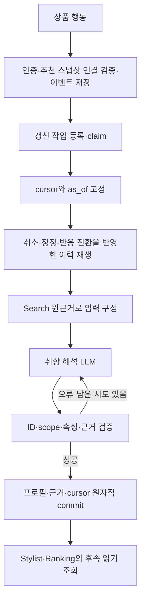

# Preference — 행동 근거에서 취향 프로필 생성

현재 서비스: **v4**, 저장 `schema_version='3.0'`, `interpretation_version='preference-interpretation-v4'`. [전체 구조](architecture.md) · [Stylist](stylist.md) · [Ranking](ranking.md)

## 1. 역할과 책임

사용자의 유효 행동과 당시 상품의 저장된 Search 근거를 읽어 범위·방향·불확실성을 가진 취향 해석을 만든다. 추천 계획 밖의 백그라운드 작업으로 실행되며, 현재 요청의 상품 순위를 직접 정하지 않는다. 이미지·상품 특징을 새로 추출하지 않고 저장된 관찰을 재사용한다.

현재 프로필의 중심은 자연어 해석과 근거다. 행동 종류에 고정 점수를 곱해 선호 점수를 만드는 경로를 현재 v4의 취향 생성 방식으로 설명해서는 안 된다. Ranking은 저장된 해석을 별도로 후보에 적용한다.

## 2. 구조와 코드 지도

| 파일 | 역할 |
| --- | --- |
| [agents/preference.py](../src/fashion_recommendation_v2/agents/preference.py) | 서비스 처리기, 버전 선택·비용·산출물 저장 |
| [agents/preference_interpretation_runner.py](../src/fashion_recommendation_v2/agents/preference_interpretation_runner.py) | 현재 해석 `PreferenceAgent`, 생성·교정·프로필 구성 |
| [preference/interpretation_input.py](../src/fashion_recommendation_v2/preference/interpretation_input.py) | `prepare_input`: cursor·시간·소유권 검증과 유효 이력 구성 |
| [preference/interpretation_sources.py](../src/fashion_recommendation_v2/preference/interpretation_sources.py) | `event_evidence`, `validate_references`: 관찰 출처·인용 검증 |
| [preference/interpretation_attributes.py](../src/fashion_recommendation_v2/preference/interpretation_attributes.py) | 속성 분류와 실제 detail 키 |
| [preference/profile_lookup.py](../src/fashion_recommendation_v2/preference/profile_lookup.py) | 후속 에이전트용 인증된 읽기 묶음 |
| [server/preference_runtime.py](../src/fashion_recommendation_v2/server/preference_runtime.py) | 작업 스캔·claim·lease 갱신·완료/실패 |
| [storage/preference.py](../src/fashion_recommendation_v2/storage/preference.py) | 이벤트 재생·프로필·근거·cursor의 원자적 저장 |
| [schemas/preference/interpretation/preference_interpretation.py](../src/fashion_recommendation_v2/schemas/preference/interpretation/preference_interpretation.py) | 입력·해석·저장 프로필 |
| [prompts/preference.py](../src/fashion_recommendation_v2/prompts/preference.py) | `PREFERENCE_INTERPRETATION_PROMPT` |

## 3. 입력과 출력

서비스 입력은 claim된 작업, 이전 프로필, cursor 범위의 이벤트, 해당 상품 스냅샷, 고정 `as_of`다. 모델 입력은 여기서 검증·재생한 사실만 투영한다.

| 모델 입력 | 의미 |
| --- | --- |
| `as_of` | 이번 해석의 기준 시각 |
| `categories` | 실제 카테고리 ID와 경로·관련 스냅샷 |
| `products` | 상품·스냅샷별 행동 목록과 사실상의 개수 |
| `evidence` | 이벤트·상품·스냅샷·관찰 경로가 연결된 근거 |
| `previous_profile` | 이전 해석 맥락, 없으면 null |
| `allowed_detail_keys` | 실제 관찰에 존재하는 detail 키 |
| `feedback` | 최초에는 null, 교정 시 검증 피드백 |

모델 출력은 `interpretations`와 `summary`다. 각 해석은 다음을 포함한다.

| 필드 | 의미 |
| --- | --- |
| `preference`, `direction` | 취향 문장과 positive/negative/mixed |
| `attributes`, `detail_keys` | 해석 대상 속성, 실제 detail 키 |
| `scope` | global 또는 지정 category 범위 |
| `supporting_evidence_refs`, `counter_evidence_refs` | 지지·반대 행동/관찰 근거 |
| `confidence`, `importance` | 추론 타당성과 개인화 우선순위의 별도 정성 등급 |
| `uncertainty` | 원인 분리·정보 부족·일반화 한계 |

코드는 `interpretation_id`, 사용자 소유자, 증가한 `profile_version`, `updated_at`, `as_of`, `processed_event_cursor`를 붙여 저장 프로필을 만든다. `UpdateOutput`은 프로필과 근거를 저장 계층에 반환한다.

## 4. 실행 흐름



작업 중 도착한 새 이벤트는 고정 cursor를 넘어 현재 입력에 섞지 않고 다음 작업에 남긴다. 추천 실행은 프로필 갱신 완료를 항상 기다리는 구조가 아니다.

## 5. 기능별 처리 방식

**사용자·행동 연결.** 서버 발급 익명 식별자와 사용자 소유의 세션·추천·상품 스냅샷을 연결한다. 동일 이벤트 재전송은 중복 반영하지 않고, 같은 ID의 다른 내용을 조용히 덮어쓰지 않는다. click/like/dislike와 저장 계약의 purchase 구분, online/offline 저장 경계를 지킨다.

**유효 이력 재생.** `record`, `cancel`, `correct`를 반영한다. 취소는 반대 행동을 새로 더하는 것이 아니다. 동일 사용자·세션·상품의 클릭은 유효 이력에서 최대 3개를 사용하고, like/dislike는 현재 유효 반응을 따른다. 아직 도착하지 않은 대상 이벤트의 취소·정정은 원본을 보존한 뒤 재생 규칙으로 처리한다.

**근거 구성.** 취소된 이벤트도 소유권·스냅샷·시각의 구조 정합성을 확인한다. 최종 유효 행동별로 Search 관찰의 출처 경로를 근거 ID에 연결한다. 같은 이벤트의 여러 속성을 서로 독립된 행동 수로 부풀리지 않는다. 상품의 사이즈 옵션이나 계절 표기를 사용자 신체·실제 구매 계절로 바꾸지 않는다.

**해석.** 관련 상품·행동의 공통점과 반대 근거를 함께 보고 적용 범위를 작성한다. 함께 존재한 소재·색·디자인 중 어느 것이 행동 원인인지 분리하기 어려우면 불확실성을 남긴다. 이전 프로필은 현재 근거를 대신하는 무조건적인 사실이 아니다.

**Confidence와 importance.** Confidence는 해당 취향 문장을 행동에서 추론하는 타당성이다. Importance는 그 해석이 타당하다고 가정할 때 범위 안에서 우선 고려할 정도다. 둘 다 low/medium/high지만 서로 같게 맞추지 않는다. 상품 정보가 확실하다고 취향 추론까지 high가 되는 것은 아니며, importance를 Ranking 가중치로 직접 변환하지 않는다.

**저장·조회.** 저장할 때 사용자 생존·소유권, 기대 프로필 버전, 작업 lease를 다시 확인한다. 프로필·근거·cursor를 한 트랜잭션으로 확정한다. 조회 어댑터는 저장 프로필·근거·스냅샷을 일관된 읽기 묶음으로 제공하며 모델이 사용자 ID를 선택할 수 없다.

## 6. LLM과 코드의 역할

LLM은 취향 문장·scope·방향·속성·confidence·importance·불확실성을 판단한다. 코드는 사실 입력, 이력 재생, 참조·속성 검증, 입력량·시도 제한, ID·버전·원자적 저장을 담당한다. 현재 입력 준비는 시간 감쇠나 수치 선호 점수를 계산하지 않는다. 코드가 모델의 등급을 근거 수에 따라 사후 재분류하지 않는다.

## 7. 프롬프트 구성

[취향 프롬프트](../src/fashion_recommendation_v2/prompts/preference.py)는 행동과 관찰의 구분, 단일 상품 반응의 일반화 제한, like/dislike의 주요 근거 검토, 공유 근거·복합 속성의 불확실성을 다룬다. 실제 근거 ID와 카테고리·detail 허용 범위를 전달한다.

Confidence와 importance의 독립적인 정의와 조합 예시를 포함한다. 프롬프트의 예시는 현재 사용자의 추가 근거가 아니다. 교정 시 같은 출력 계약과 검증 오류를 `feedback`으로 전달하며 실제 ID나 관찰을 코드가 만들어 채우지 않는다.

## 8. 정책과 종료 조건

- 서비스 진입점의 `--preference-version` 기본값은 v4이며 현재 추천 소비자는 v4를 요구한다.
- 모델은 서버의 `--model`을 전달받는다. 기본값은 `gpt-5.6-sol`이며 Ranking 취향 평가 모델과 구분한다.
- `InterpretationConfig.max_retries=2`: 최초 포함 최대 3회 해석 시도다.
- 입력 예산은 최대 **320,000 bytes**다. 직렬화 입력, 프롬프트·스키마 여유분을 포함하는 코드 계산이며 토큰 수가 아니다.
- 예산 초과 시 이력을 임의로 잘라 부분 프로필을 발행하지 않는다.
- 새 수신 경계가 없으면 새 해석을 하지 않는다. 작업 cursor와 `as_of`를 고정하고 코드가 임의로 현재 시각으로 바꾸지 않는다.
- 미처리 작업 스캔은 60초, 만료 사용자 정리는 3,600초 주기이며 세션 종료도 갱신 작업 등록을 시도한다. 작업 등록과 즉시 실행·완료는 다르다.
- 작업 lease 기본값은 300초이고 runtime이 주기적으로 갱신한다. 소유권을 잃은 작업은 결과를 commit하지 못한다.

## 9. 실패와 복구

API·파싱·근거 검증 오류는 시도별 원응답·실패 정보를 보존하고 제한된 교정을 수행한다. 재시도 소진을 runtime에 표시하여 내부 교정 한도를 작업 재시도로 무한 증폭하지 않도록 한다. 구체적인 작업 재시도·회수 정책은 [runtime](../src/fashion_recommendation_v2/server/preference_runtime.py)과 [저장소](../src/fashion_recommendation_v2/storage/preference.py)에 있다.

사용자 만료·삭제·프로필 버전 충돌·lease 상실 시 새 결과를 저장하지 않는다. 실패한 새 프로필로 정상 저장 프로필을 덮어쓰지 않는다. 산출물 저장도 만료된 사용자를 다시 만들지 않는다. 원본 이벤트는 취소·정정의 재현을 위해 보존하며 실제 사용자 데이터는 공개 fixture로 복사하지 않는다.

## 10. 실행 예제와 테스트

합성 사례로 동일 사용자가 무늬가 다른 셔츠 두 개에 like/dislike를 남겼다고 가정한다. 모델은 관찰에서 확인된 특징과 반응을 연결하되, 무늬가 행동 원인이라고 단정하지 않고 다른 차이·반대 근거를 함께 설명해야 한다. 한 개 like만으로 “항상 이 스타일을 선호한다”고 일반화하지 않는다.

아래 명령은 실제 API를 호출하지 않는 저장·서비스·현재 계약 검사다.

```sh
PYTHONPATH=src python -m pytest -q tests/test_preference_storage.py tests/test_preference_server.py tests/test_service_release.py
```

[저장소 테스트](../tests/test_preference_storage.py)는 이벤트·중복·소유권·작업·원자적 저장의 대표 사례를, [서버 테스트](../tests/test_preference_server.py)는 쿠키·Origin·CSRF·수집·worker 경계를 검사한다. 일부 테스트는 공통 저장 계약을 사용하며 Preference v4의 실제 해석 품질을 검증하지 않는다.

실제 동작은 [서비스 실행](architecture.md#로컬-실행과-합성-예제) 후 직접 생성한 추천에 행동을 남기고 작업 완료 뒤 저장 프로필을 확인한다. 임의의 쿠키·실제 사용자 로그를 명령 예제로 공유하지 않는다. 행동 직후 추천에 즉시 반영된다고 가정하지 않는다.

## 11. 설계 이유와 한계

관찰→행동→취향의 근거 연결을 유지해 저장 해석을 추적할 수 있게 한다. 배경 작업과 읽기 전용 조회를 분리하여 추천 요청 중 프로필이 바뀌더라도 단계 내부 판단 기준을 고정한다. 다만 Stylist와 Ranking의 별도 조회가 항상 같은 프로필 버전을 보았다는 전역 보장은 별도 확인이 필요하다.

브라우저 기반 익명 사용자는 여러 기기의 동일 인물이나 공유 브라우저의 서로 다른 사람을 자동 구별하지 못한다. 행동의 인과 해석과 장기 선호 일반화도 모델 판단의 한계가 있다. 저장소 검증과 스키마 통과는 추론된 취향의 정확성 보장이 아니다.
