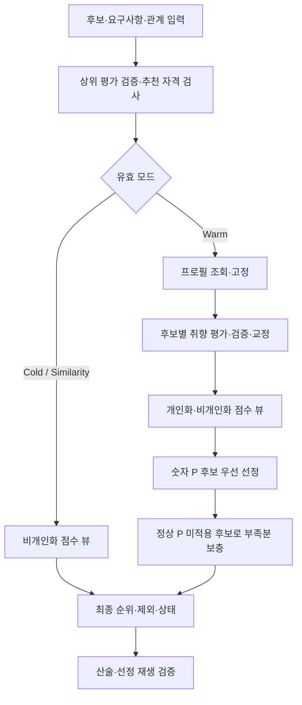

# Ranking — 추천 자격, 점수와 최종 선정

현재 서비스: **v17** (`ranking_eval_v17`). [전체 구조](architecture.md) · [Relation](relation.md) · [Summary](summary.md)

## v17의 선택 가중치

아래 대상 경로는 v17의 선택 가중치를 적용한다. 뒤의 기본식은 상속된 나머지 경로의 설명이며 이 세 경로에서는 아래 값이 우선한다.

| 경로 | R | Q | T | P | Relation |
| --- | --- | --- | --- | --- | --- |
| Cold, 관계 없음, R 활성 (A9) | 0.40 | 0.50 | 0.10 | 0 | 0 |
| Warm, 관계 없음, 유효 P (B11) | 0.34375 | 0.13750 | 0.06875 | 0.45 | 0 |
| Cold, 순수 유사성, R 비활성 (C12) | 0 | 0 | 0.05 | 0 | 0.95 |

P가 없거나 다른 관계인 경로는 상속 정책을 따른다. 개인화 평가는 v16 응답 계약을 사용하며 모델이 `used_attributes`·`used_detail_keys`를 중복 작성하지 않는다.

## 1. 역할과 책임

Search 후보의 저장 근거를 검증하고 추천 자격을 판단한 뒤 요청 적합도·썸네일·검색 신호·관계·취향을 반영해 요청 개수만큼 선정한다. 상품을 새로 검색하거나 이미지를 다시 분석하지 않는다. LLM은 Warm 후보의 취향 적합성을 평가하며, 최종 계산과 정렬은 코드가 담당한다.

## 2. 구조와 코드 지도

| 파일 | 역할 |
| --- | --- |
| [agents/ranking.py](../src/fashion_recommendation_v2/agents/ranking.py), [ranking_runner.py](../src/fashion_recommendation_v2/agents/ranking_runner.py) | `RankingAgent`, `RankingRunner.run`, 후보 제외·점수·정렬 |
| [agents/ranking_brain.py](../src/fashion_recommendation_v2/agents/ranking_brain.py) | 프로필 조회 요청과 취향 평가 LLM |
| [ranking/ranking_contracts.py](../src/fashion_recommendation_v2/ranking/ranking_contracts.py) | 현재 모델·예산·입력·실행 연결 |
| [ranking/partial_evaluation.py](../src/fashion_recommendation_v2/ranking/partial_evaluation.py) | `project`: 상위 평가 실패 후보 분리 |
| [ranking/personalization.py](../src/fashion_recommendation_v2/ranking/personalization.py) | `evaluate`, 점수 매핑, 두 점수 뷰·선정·재생 검증 |
| [ranking/ranking_scoring.py](../src/fashion_recommendation_v2/ranking/ranking_scoring.py), [ranking_policy.py](../src/fashion_recommendation_v2/ranking/ranking_policy.py) | R·관계 결합·감점·다양성 정책 |
| [schemas/ranking.py](../src/fashion_recommendation_v2/schemas/ranking.py) | 입력·FinalRanking·점수 검증 |
| [prompts/ranking.py](../src/fashion_recommendation_v2/prompts/ranking.py) | 취향 평가 프롬프트 |

## 3. 입력과 출력

필수 입력은 `candidate_set`, `user_request`, `requested_count`, 명시적인 `personalization_mode`다. 관계 요청은 `relation_intent`와 `ralationRatio`의 기준·후보 연결을 검증한다. 저장 프로필은 인증된 조회 어댑터로 가져오며 요청 본문에서 임의의 사용자 프로필을 선택하지 않는다.

| 결과 | 의미 |
| --- | --- |
| `ranked_items` | 최종 순위·상품 ID·점수 구성·근거 |
| `excluded_items` | 제외 사유와 관련 평가 진단 |
| `requested_count`, `returned_count`, `status` | 목표·실제 개수와 `complete`/`partial`/`empty` |
| `shortfall_reasons`, `warnings` | 부족·제약 안내용 정보 |
| `personalization_v12` | 현재 개인화 기록: 고정 프로필, 시도, 점수 뷰, 선택 유형 |
| `upstream_exclusions_v10` | Search/Relation 실패·미평가에 따른 제외 |

숫자 접미사는 현재 저장 필드 이름이다. 실행 정책은 `scoring_policy_version`과 개인화 기록의 `policy_version`으로 확인한다.

## 4. 실행 흐름



## 5. 기능별 처리 방식

**추천 자격.** Search 평가 부재·실패·근거 불일치, 필수 Relation 평가 실패·미평가를 먼저 분리한다. 노출 제한(`restricted`), 아동복 정책, 활성 요청 적합도 R의 최소 기준 등을 적용한다. 제외 상품을 개수 보충으로 되살리지 않는다.

**요청 점수 R.** `resolved_requirements`에서 Ranking 담당 soft 조건만 사용한다. 판정별 값은 `met=1`, `mostly_met=.75`, `partial=.5`, `unknown=.4`, `unmet=0`이다. 관련 메타데이터·이미지 일치 상태의 감점을 반영하며 이미 점수화한 불확실성과 바닥 점수를 중복 감점하지 않는다. 대안 중 실제 충족된 조건과 그 근거를 연결한다. R은 각 조건의 `max(0, 판정 점수 − 감점)`의 평균이다. 일치 상태 감점은 consistent=0, partially_consistent=.10, inconsistent=.25, visually_indeterminate=.05, metadata_missing=0, not_applicable=0, observation_unavailable=.05다. 한 조건에 여러 근거가 연결되면 해당 정책의 최대 감점을 사용한다. 적용할 조건이 없으면 R은 1이 아니라 `null`이다.

**썸네일 Q·검색 T.** Q는 Search가 저장한 썸네일 관찰과 그 검토 상태에서 계산한다. 검토 근거가 없거나 유효하지 않을 때는 명시적인 unknown fallback을 사용하며 새로운 시각 관찰을 꾸미지 않는다. T는 검색 결과의 원래 순서와 서로 다른 검색 방향에서의 출현을 이용한다. 같은 쿼리를 반복했다고 독립적인 출현으로 중복 계산하지 않는다.

Q의 기본 가중치는 사진 유형 .35, 상품 노출 범위 .15, 상품 사진 품질 .35, 진열 방식 .06, 배경 .06, 촬영 방향 .03이다. 사람 사진에서는 진열 방식을, 상품 단독 사진이 아니면 상품 사진 품질을 빼고 남은 가중치 합으로 나눈다. 항목별 점수표는 [schemas/ranking.py](../src/fashion_recommendation_v2/schemas/ranking.py)의 `thumbnail_components_v2`가 사용한다.

T는 `0.8N + 0.2F`다. N은 성공한 검색에서의 최상위 원래 순서에 대해 `1/sqrt(order)`이고, F는 고유한 성공 검색 방향 수 q와 후보 출현 방향 수 a로 계산한다. q>1이면 `F=clamp((a−1)/(min(q,3)−1),0,1)`, 아니면 0이다. 방향은 정규화된 쿼리·카테고리·필터 조합으로 구분한다.

**프로필 고정.** 조회한 프로필 버전·기준 시각·내용 해시·근거 묶음을 해당 실행에서 고정한다. 조회는 프로필 생성이나 갱신이 아니다. 모델에 후보의 R/Q/T/Relation 점수·기존 순위를 보여주어 취향 점수를 따라 쓰게 하지 않는다.

**취향 적용 범위.** 모델이 먼저 해당 해석의 scope가 상품에 적용되는지 판단한다. scope 미적용이면 `out_of_scope`; 적용된다면 사용자 명시 속성과 size 등 코드 제외 범위를 확인한다. 복합 취향의 일부 속성만 떼어 새로운 독립 선호로 만들지 않는다.

**두 단계 선정.** 숫자 P가 있는 후보를 개인화 점수로 먼저 선정한다. 부족분은 정상적인 P 미적용 후보의 비개인화 순위로 채운다. 두 그룹을 연결한 뒤 점수 크기로 다시 섞지 않는다. 비개인화 뷰는 원래 후보 풀의 검색 신호를 유지한다.

## 6. LLM과 코드의 역할

LLM은 모든 저장 해석 ID에 대해 `supports`, `opposes`, `neutral`, `unknown`, `conflicted`, `not_applicable`과 근거를 반환하고 상품 전체 `overall_fit`을 판단한다. 코드는 ID·출처·범위·등급 정합성을 검사하고 아래처럼 P를 정한다.

| overall_fit | P |
| --- | --- |
| strong_mismatch | 0 |
| mismatch | .25 |
| neutral | .5 |
| match | .75 |
| strong_match | 1 |
| undetermined | null |

`P=0`도 취향 평가가 적용된 개인화 후보다. `null`은 점수 0과 다르다. 평가 재실패를 `undetermined`로 바꿔 보충 후보에 넣지 않는다.

## 7. 프롬프트 구성

[취향 프롬프트](../src/fashion_recommendation_v2/prompts/ranking.py)는 현재 요청·제외 속성, 고정된 프로필과 행동 근거, 후보의 저장 관찰을 사용한다. scope 우선 판단, 반대 취향·중립·미확인을 구분하고 모든 해석 ID를 정확히 한 번 반환하도록 요구한다. 교정도 같은 고정 입력으로 수행하며 오류 피드백과 원응답 기록을 남긴다.

## 8. 정책과 종료 조건

모델은 취향 평가·조회에 `gpt-6-luna`, 후보 최대 50개, 동시 취향 평가 최대 40개, 조회를 포함한 호출 예산 최대 100회다. 후보별 최초·교정은 최대 2회이며 최초 평가 후 실패 후보를 교정한다. Similarity는 유효 Cold 모드로 조회·P 평가를 생략한다.

R이 활성일 때 기본 점수 B는 다음과 같다. 여기서 개인화는 요청이 Warm인지가 아니라 해당 후보에 숫자 P가 있는지를 뜻한다.

```text
P 미적용: B = .55R + .35Q + .10T
P 적용:   B = .50R + .20P + .20Q + .10T
```

R 활성 상태에서 관계 점수 L을 결합하는 정책:

| 상태 | 점수 |
| --- | --- |
| 관계 없음 | B |
| Compatibility 숫자 L | .75B + .25L |
| Similarity 숫자 L, coverage=1 | .60B + .40L |
| Similarity 숫자 L, 부분 coverage | .65B + .35L |
| Similarity coverage 부족으로 정상 null | .75B (관계 기여 0) |
| 그 외 정상 null | 기본 적용 기록의 fallback에 따라 B |

R이 비활성이면 위 B 식을 쓰지 않고 `routed_score`의 별도 경로를 따른다.

```text
관계 있음, P 미적용: .35Q + .10T + .55L
관계 있음, P 적용:   .20Q + .10T + .20P + .50L
관계 없음: 해당 식에서 L을 제외한 나머지 가중치를 합 1로 재정규화
```

이 경로의 정상 L=null은 관계 기여 0이며 관계 가중치를 다른 점수에 나눠주지 않는다. 필수 관계 평가 실패·미평가는 앞선 제외 단계의 대상이다. 활성 R<.5는 제외하지만 R=null에 이 임계값을 적용하지 않는다.

현재 서비스는 다양성 감점을 적용하지 않는다(`DIVERSITY_ENABLED=False`). 점수·R 다음 동점 해소에는 고정 seed 기반 값을 사용하며 기본 seed는 42다. 그룹 연결 때문에 최종 순위 전체가 하나의 점수 내림차순인 것은 아니다. 요청 개수만큼 유효 후보가 없으면 partial/empty로 종료한다.

## 9. 실패와 복구

프로필 `not_found`/`empty`는 정상 미적용 경로다. 조회 실패를 프로필 없음으로 숨기지 않는다. 일부 후보 P 평가 재실패는 제외하고 나머지를 보존하며, 모든 P 평가가 실패하면 개인화 실행 오류가 될 수 있다. 상위 실패 후보의 제외 사유를 원입력과 대조한다.

출력 검증은 점수와 선택을 코드로 재생한다. 같은 요청의 동일 스냅샷에 대한 성공 검증만 재사용하고 변경·실패·다른 요청에는 새 검증을 수행한다.

## 10. 실행 예제와 테스트

가상의 적격 후보가 P=.75, P=0, P=null 세 개뿐이고 5개 요청이라면 숫자 P 두 개를 개인화 그룹에서 정렬한 뒤 정상 null 후보를 보충한다. 최종 3개이므로 partial이며, P=0인 상품을 취향 미반영으로 표시해서는 안 된다.

```sh
PYTHONPATH=src python -m pytest -q tests/test_role_consolidation.py::test_synthetic_service_outputs_match_before_consolidation
```

[합성 회귀](../tests/test_role_consolidation.py)는 Cold/Warm, similarity/일반, 프로필 있음/없음/평가 실패 결과와 호출 수를 비교한다. [실행기](../tests/role_behavior_capture.py)의 fixture는 합성 데이터다. 모든 점수 조합·실제 개인화 품질을 포괄하는 테스트는 아니며 Live 실행 방법은 [전체 안내](architecture.md#로컬-실행과-합성-예제)를 따른다.

## 11. 설계 이유와 한계

취향 판단과 산술·선정을 분리해 모델의 점수 임의 계산을 막고 결과를 재검증한다. 개인화 우선·비개인화 보충은 서로 다른 점수 체계를 무리하게 합쳐 정렬하지 않기 위한 정책이다. 다만 숫자 P가 있는 낮은 적합도 후보도 개인화 그룹에 속한다. 이 선택 정책의 실제 사용자 만족도와 가중치 적정성은 별도 품질 평가가 필요하다.
