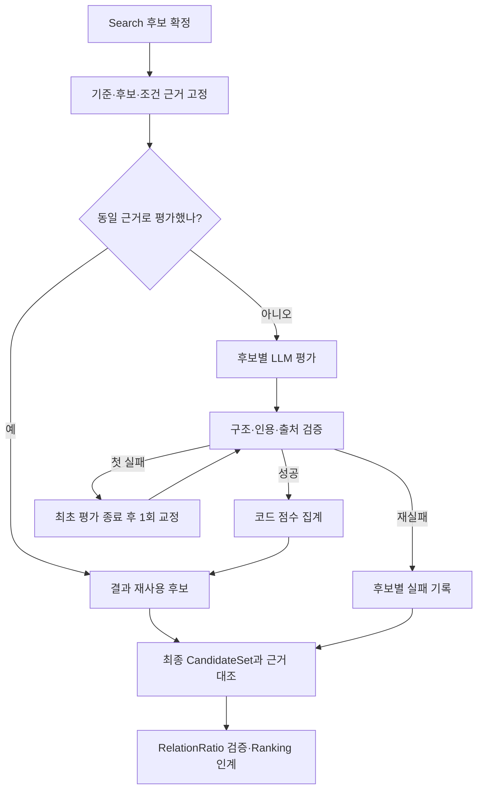

# Relation — 기준 상품과 후보의 관계 평가

현재 서비스: **v8**. [전체 구조](architecture.md) · [Search](search.md) · [Ranking](ranking.md)

## 1. 역할과 책임

하나의 기준과 각 후보 사이의 similarity 또는 compatibility를 평가한다. 후보들 사이의 모든 쌍을 비교하지 않는다. Similarity는 특정 상품의 저장 스냅샷이 필요하고, compatibility는 일반 카테고리 또는 특정 상품을 기준으로 삼는다. 일반 카테고리에 없는 색·핏·소재를 임의로 채우지 않는다.

검색 방향은 Search·Stylist, 요청 적합도와 취향 점수·최종 선정은 Ranking의 책임이다. Relation 점수는 관계 적합도 지수이며 확률이 아니다.

## 2. 구조와 코드 지도

| 파일 | 역할 |
| --- | --- |
| [agents/relation.py](../src/fashion_recommendation_v2/agents/relation.py) | `RelationAgent.run`: 입력·생성·검증·교정 경계 |
| [relation/relation_contracts.py](../src/fashion_recommendation_v2/relation/relation_contracts.py) | 모델, 응답 계약, 실행·점수 모듈 연결 |
| [relation/execution.py](../src/fashion_recommendation_v2/relation/execution.py) | 후보별 실행, worker·호출 예산, 상태 |
| [relation/streaming.py](../src/fashion_recommendation_v2/relation/streaming.py) | `StreamingRelation`: Search 중 선행 평가·최종 대조 |
| [relation/relation_evidence.py](../src/fashion_recommendation_v2/relation/relation_evidence.py) | 원근거 투영·인용·출처 검증 |
| [relation/relation_scoring.py](../src/fashion_recommendation_v2/relation/relation_scoring.py) | `aggregate`, `derive`, `policy_context`: 가중치·coverage·집계 |
| [schemas/relation.py](../src/fashion_recommendation_v2/schemas/relation.py), [relation_scoring.py](../src/fashion_recommendation_v2/schemas/relation_scoring.py) | 입력·결과·세부 판단 계약 |
| [prompts/relation.py](../src/fashion_recommendation_v2/prompts/relation.py) | 현재 공유하는 평가 rubric·교정 지시 |

## 3. 입력과 출력

입력 `RelationAgentInput`은 `candidate_set`, 확정 `intent`, 필요한 `anchor_item`과 `anchor_search_analysis`, `evaluation_version='v8'`를 연결한다. 번호 참조는 서버에서 실제 상품으로 복원한 뒤 전달한다.

| 출력 필드 | 의미 |
| --- | --- |
| `candidate_set_id`, `intent`, `anchor_item` | 평가 대상 풀과 기준의 연결 |
| `evaluations` | 후보별 점수·이유·차이·불확실성·근거 참조 |
| `score_breakdowns_v5` | 현재 점수 계약의 criterion/facet별 점수·coverage·null 사유 |
| `item_statuses_v7` | 현재 실행 계약의 `success`/`fail`/`unevaluated`, 호출·오류 기록 |
| `unevaluated_item_ids` | 실패 또는 미평가 후보 |
| `evidence_input_sha256` | 평가에 사용한 근거 스냅샷 연결 |
| `omitted`, `warnings` | 관계 구절 제외와 경고 |

후속 상태·입력 이름은 실제 철자 그대로 `ralationRatio`다. 정상적인 점수 `null`과 실행 실패는 다르다. 숫자 0, 숫자 점수, 정상 null은 모두 성공 평가일 수 있다.

## 4. 실행 흐름



수정된 근거의 결과는 그대로 재사용하지 않는다. 남은 기존 예산으로 다시 평가할 수 없으면 미평가로 남긴다. 최종 풀에서 제거된 후보의 결과도 최종 Ranking에 넘기지 않는다.

## 5. 기능별 처리 방식

**근거 투영.** Search의 `attributes`에서 메타데이터·이미지 관찰·일치 상태를 전달한다. 원본 키와 값, item/image/snapshot 연결을 보존하고 원본 판매 정보로 누락된 관찰을 몰래 채우지 않는다.

**출처 선택.** LLM은 관련된 알려진 관찰을 선택하고 실제 근거를 인용한다. 시각적 속성은 관련 이미지 관찰이 충분하지 않을 때 허용된 메타데이터를 쓴 이유를 기록한다. 소재·계절은 메타데이터 전용 기준으로 다루며 `metadata_fallbacks` 대상으로 만들지 않는다. 이미지 URL의 존재만으로 새 이미지를 봤다고 해석하지 않는다.

**세부 평가.** criterion 안의 facet마다 `assessed`, 미확인·충돌·미적용 등의 상태와 근거를 기록한다. `not_applicable`은 패턴 크기·분포·소매 길이처럼 코드가 허용한 facet에만 쓴다. 자료 부족을 임의의 낮은 점수로 대체하지 않는다.

**부분 근거 집계.** 판정 가능한 facet에 원래 비중을 적용해 criterion 점수를 구한다. 미확인 facet은 coverage를 낮춘다. 허용된 미적용 facet은 정해진 그룹 안의 적용 가능 분모에서 제외한다. criterion별 `weight × coverage`를 유효 가중치로 사용한다.

## 6. LLM과 코드의 역할

LLM이 관계의 의미, facet 판정·점수와 인용·이유를 작성한다. 코드는 허용 기준·facet의 누락/중복, score/state 정합성, 근거 소속을 검사하고 최종 점수를 집계한다. 총점·coverage·가중치를 모델의 자유 계산에 맡기지 않는다.

## 7. 프롬프트 구성

[Relation 프롬프트](../src/fashion_recommendation_v2/prompts/relation.py)의 현재 연결 상수는 `RELATION_PROMPT_V6`다. 이는 현재 서비스 v8이 사용하는 공통 평가 계약 이름이다. 관계 유형, 기준·후보의 출처별 근거, rubric, 코드 정책을 입력에 연결한다.

교정에서는 동일 근거와 이전 응답의 검증 오류를 제공한다. 근거 부족·충돌을 숨기거나 인용 경로를 자동 보정하지 않는다. 원응답, `code_validation`, 파생 점수·상태를 별도로 저장한다.

## 8. 정책과 종료 조건

| 항목 | 현재 값 |
| --- | --- |
| 모델 | `gpt-6-luna` |
| 호출 단위 | 후보 1개 |
| 후보 상한 | 50개 |
| 실행 인스턴스 병렬 상한 | 20개 |
| 평가·교정 호출 상한 | 총 100회 |
| 후보별 시도 | 최초 1회 + 실패 시 교정 1회 |

정상 후보는 다시 호출하지 않는다. 처음 평가할 후보에 예산을 먼저 배정하고, 남은 예산에서 실패 후보를 원래 순서로 교정한다. 여러 추천 요청을 동시에 실행하면 서비스 전체 동시성은 이 인스턴스 제한과 다르다.

| 관계 | criterion 가중치 | 최소 전체 coverage | 반드시 평가 가능한 criterion |
| --- | --- | --- | --- |
| Similarity | 종류 .35, 색 .30, 패턴 .10, 길이 .10, 디테일 .10, 소재 .05 | .80 | product_type |
| Compatibility | category_pairing·color_pattern·style·season·use_context 각 .20 | .60 | category_pairing |

```text
유효 가중치 = criterion 가중치 × criterion coverage
총점 = Σ(criterion 점수 × 유효 가중치) / Σ(유효 가중치)
```

필수 criterion이 평가 불가능하거나 전체 coverage가 기준 미만이면 총점은 `null`이다. 완전한 근거가 있어 0점인 경우와 구분한다. Compatibility의 색·패턴 복합 criterion은 내부 그룹 비중도 적용하므로 단순히 모든 facet을 같은 비중으로 평균하지 않는다.

## 9. 실패와 복구

개별 후보의 API·파싱·근거 검증 실패는 격리한다. 두 번 실패하면 `fail`, 예산·후보 상한 때문에 시작하거나 교정을 완료하지 못하면 `unevaluated`로 기록한다. 빈 후보에는 LLM을 호출하지 않는다.

전체 입력의 기준·후보·해시 불일치는 공유 계약 오류다. 정상 null은 Ranking의 별도 관계 적용 정책을 따르지만, 필수 관계 평가 실패·미평가를 정상 null로 바꾸지 않는다. 실패 여부는 최종 error 수뿐 아니라 시도 기록과 후보 상태로 확인한다.

## 10. 실행 예제와 테스트

합성 입력 예시는 **청바지와 어울리는 상의**의 카테고리 compatibility와 **이전 3번 상품과 비슷한 상품**의 특정 상품 similarity다. 일반 청바지에는 임의의 색·핏을 넣지 않고, 후속 번호는 실제 저장 결과에서 찾아야 한다.

아래는 결과 상태의 의미를 보여주는 발췌다.

```json
{"item_id":"synthetic_item","score":null,"uncertainties":["관계 판정에 필요한 근거 부족"]}
```

이 발췌만으로 전체 결과를 검증할 수는 없다. 실제 결과에는 입력에 일치하는 breakdown과 상태가 함께 있어야 한다.

```sh
PYTHONPATH=src python -m pytest -q tests/test_role_consolidation.py::test_synthetic_service_outputs_match_before_consolidation
```

[합성 동작 검사](../tests/test_role_consolidation.py)와 [모의 응답 실행기](../tests/role_behavior_capture.py)는 Relation v8 성공·교정·재실패 출력과 호출 수를 비교한다. 네트워크를 차단하므로 모델의 실제 관계 판단 품질·API 지연은 검사하지 않는다.

## 11. 설계 이유와 한계

후보별 호출로 한 상품의 오류가 다른 결과를 무효화하지 않도록 한다. Search와 평가를 겹치되 최종 근거 대조를 유지한다. 점수 가중치와 coverage는 코드 정책이며 사용자 선호의 확률이나 추천 품질의 객관적 보증이 아니다. 관찰 자체의 오류와 모델의 의미적 판단 오류는 구조 검증만으로 모두 잡을 수 없다.
