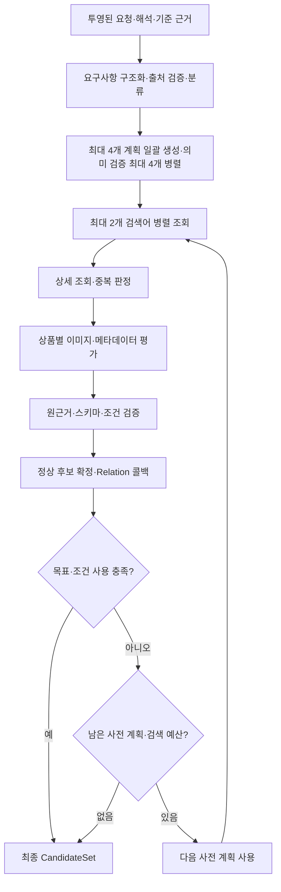

# Search — 조건 구조화, 상품 조회와 후보 평가

현재 서비스: **v61**. [전체 구조](architecture.md) · [Relation](relation.md) · [Ranking](ranking.md)

## 현재 계획 방식

v60부터 최대 4개 검색어·필터를 한 호출에서 생성하고 이미 만든 계획으로 검색한다. v61은 각 계획의 독립 의미 검증을 최대 4개 병렬로 처리한다. 결과·감사 기록은 원래 순서로 합치며 계획 간 중복·전체 조건 검사는 유지한다. 검색어 생성 자체를 4회 병렬 호출하는 구조는 아니다.

## 1. 역할과 책임

사용자 조건과 Stylist의 검증된 해석을 검색 요구사항으로 고정하고 eBay에서 상품을 조회한다. 상품의 판매 정보·이미지 관찰·조건 판정을 저장하여 후속 평가가 같은 근거를 사용하게 한다. 최종 추천 5개를 선정하거나 사용자용 설명을 작성하지 않는다.

## 2. 구조와 코드 지도

| 파일 | 역할 |
| --- | --- |
| [agents/search_runner.py](../src/fashion_recommendation_v2/agents/search_runner.py) | `SearchVisualRunner`, `run_parallel_search`: 검색 라운드·후보·예산 |
| [agents/search_brain.py](../src/fashion_recommendation_v2/agents/search_brain.py) | 요구사항·계획·평가 LLM의 호출 경계 |
| [search/contracts.py](../src/fashion_recommendation_v2/search/contracts.py), [policy.py](../src/fashion_recommendation_v2/search/policy.py) | 역할 계약, 모델 라우팅·목표·timeout·병렬도 |
| [search/requirements.py](../src/fashion_recommendation_v2/search/requirements.py), [requirement_sources.py](../src/fashion_recommendation_v2/search/requirement_sources.py) | 구조화·분류·조건 담당 단계·출처 검증 |
| [search/planning.py](../src/fashion_recommendation_v2/search/planning.py) | 검색 계획과 실제 조건 사용 기록 |
| [search/product_evaluation.py](../src/fashion_recommendation_v2/search/product_evaluation.py), [product_validation.py](../src/fashion_recommendation_v2/search/product_validation.py) | 상품 관찰·판정과 원근거 검증 |
| [search/candidate_records.py](../src/fashion_recommendation_v2/search/candidate_records.py) | 후보 확정·평가 스냅샷·콜백 |
| [tools/ebay_search.py](../src/fashion_recommendation_v2/tools/ebay_search.py), [ebay_client.py](../src/fashion_recommendation_v2/tools/ebay_client.py) | 검색·상세 조회, 인증·HTTP 처리 |
| [schemas/search/](../src/fashion_recommendation_v2/schemas/search/), [prompts/search/](../src/fashion_recommendation_v2/prompts/search/) | 단계별 입력·출력과 프롬프트 |

서비스 팩토리의 `LazySearch.run`이 클라이언트와 실행기를 요청별로 구성한다. 통합 파일 내의 함수 이름에 계약 식별자가 남아 있어도 서비스 선택은 `search_policy_version='v61'`이다.

## 3. 입력과 출력

입력 `SearchAgentInput`의 필수 필드는 `request_id`, `user_query`, `goal`, `current_date`, `requested_count`다. `stylist_resolution`, `similarity_reference`, `audience_context_v1`, `relation_intent`, `relation_anchor`는 선택 필드이며 기본 null이다. 검증된 Stylist 결과·원문 출처와 필요한 관계·기준 문맥을 이 계약으로 받는다. 개인화 전체 프로필을 검색 모델에 그대로 넘기지 않는다. Orchestrator가 제외한 미해결 조건도 재해석하지 않는다.

출력은 `CandidateSet`이다.

| 필드 | 의미 |
| --- | --- |
| `candidate_set_id`, `search_policy_version` | 후보 풀 식별자·실행 정책 |
| `resolved_requirements` | 고정 요구사항, ID·값·hard/soft·출처·scope, 담당 단계 |
| `candidates`, `candidate_count` | 중복 정리·검증을 거친 실제 후보 |
| `evaluation_item`, `search_analysis` | 후보 내부의 평가 당시 상품과 관찰·판정 |
| `search_attempts` | 쿼리·조회·조건 사용·상품 오류의 실행 기록 |
| `price_conversion` | 예산이 있을 때 사용하는 실행 단위 환율 스냅샷, 없으면 null |
| `used_requirement_ids`, `unused_requirement_ids` | 실제 검색 적용이 확인된 조건과 남은 조건 |
| `stop_reason`, `strategy_failures`, `warnings` | 종료·부분 실패·비차단 경고 |

조회량, 후보 수, 최종 추천 수는 서로 다르다. 후보 수와 실제 배열·고유 ID는 후속 인계에서 다시 검사한다.

## 4. 실행 흐름



확정 콜백은 조회만 끝난 상품이나 검증 실패 상품을 전달하지 않는다. 최종 풀의 근거 변경 여부는 Relation이 다시 대조한다.

## 5. 기능별 처리 방식

**요구사항 구조화·분류.** 원문과 해석의 출처를 보존하여 속성·값을 만들고 검색 조건과 상품 평가 조건을 구분한다. 사용자 명시 조건이 Stylist 보완보다 우선한다. OR 대안을 개별 AND 필수 조건으로 바꾸지 않는다. 제한 없음은 임의의 선호 값으로 채우지 않는다.

**관계 문맥.** Similarity는 기준 관찰 중 검색에 유용한 특징을 선별해 `source=reference`의 대상 조건으로 사용한다. 기준의 브랜드·사이즈 등 모든 특징을 복제하지 않는다. Compatibility의 앵커 특징은 구매 대상이 그대로 가져야 할 속성으로 복사하지 않는다. Relation이 평가할 조건과 Ranking이 평가할 soft 조건의 담당을 구분한다.

**검색 계획.** 구조화된 조건을 간결한 상품 키워드로 표현한다. 용도·스타일도 상품 종류를 수식하도록 쓰고, 설명 문장 전체를 검색어로 붙이지 않는다. 카테고리·필터 선택과 실제 쿼리·필터 사용 근거를 검사한다. 가격은 원래 예산과 동일 실행의 환율을 따라 적용한다.

**상품 관찰.** 메타데이터 사실, 이미지 관찰, 두 출처의 일치 여부, 요구사항 판정을 분리한다. 상태·속성·근거 경로와 평가 상품 ID·이미지 URL을 확인한다. 현재 경로에는 별도의 상품 정규화 LLM 호출이 없으며, 관찰·원본 정보의 코드 투영을 사용한다.

**통과와 후속 순위.** Search의 후보 편입과 Ranking의 최종 추천 자격은 같은 판정이 아니다. 노출 적합성·썸네일 관찰·미확인 근거 등을 후속에 보존하며 Ranking이 자기 정책으로 제외하거나 점수화한다.

**중복과 재사용.** 같은 상품을 여러 검색에서 찾으면 조회 신호를 병합한다. 평가 재사용에는 상품과 평가 문맥의 정합성이 필요하다. 이전 통과 기록만으로 바뀐 근거를 검증 없이 통과시키지 않는다. 이미 실행한 라운드의 정상 후보는 목표 수를 넘었다고 잘라내지 않는다.

**비차단 경고.** Similarity 기준이 있으나 reference 조건을 선택하지 않았다면 `reference_conditions_missing`과 미사용 사유를 기록한다. 사유가 없다는 것만으로 추가 교정 호출을 만들거나 실행을 막지 않는다. 존재하지 않는 근거 참조에 대한 검증은 별개로 유지한다.

## 6. LLM과 코드의 역할

LLM은 조건의 의미·검색어·카테고리 선택과 이미지·판매 정보 해석을 담당한다. 코드는 원문·출처·ID·스키마·산술·예산·중복·후보 확정을 통제한다. 후속 Ranking과 Relation은 저장된 관찰을 사용하며 이미지를 다시 요청해 Search의 평가를 바꾸지 않는다.

## 7. 프롬프트 구성

[requirements.py](../src/fashion_recommendation_v2/prompts/search/requirements.py)는 요청·Stylist·reference의 출처와 구조화·분류 계약을, [planning.py](../src/fashion_recommendation_v2/prompts/search/planning.py)는 검색 키워드와 사전 계획을 담당한다. v61은 검색 결과 진단으로 후속 검색어를 생성하지 않는다. [product_evaluation.py](../src/fashion_recommendation_v2/prompts/search/product_evaluation.py)는 상품별 근거·관찰·판정을, [ranking_observation.py](../src/fashion_recommendation_v2/prompts/search/ranking_observation.py)는 썸네일 등 후속 관찰을 정의한다.

교정 가능한 단계에는 원래 입력과 오류 진단을 전달한다. 원응답, 검증 결과, 코드 파생 필드는 분리한다. 프롬프트 파일이 역할별 하나라는 사실이 Search 전체가 한 번의 LLM 호출이라는 뜻은 아니다.

## 8. 정책과 종료 조건

| 제한 | 현재 서비스 값·의미 |
| --- | --- |
| 후보 목표 | `max(15, requested_count)`. 수집 종료 목표이며 절단 상한이 아님 |
| 최소 성공 검색 | 1회 |
| 검색 시도 | 최대 4회. 실패 검색도 예산 소모 |
| 검색당 조회량 | 최대 20개 |
| 동시 검색 | 최대 2개 쿼리 |
| 상세 조회 | 서비스 도구의 worker 5개 |
| 상품 LLM 평가 | 상품당 1개, 최대 40개 병렬 |
| 일반 Search LLM 호출 | 공통 상한 420초와 작업별 제한을 적용하되, 최초 계획 생성은 타임아웃 해제 |
| 이미지 평가 | 현재 상품 평가 작업 SearchVisualSlotsV57_1은 80초; 과거 작업의 180초 설정과 구분 |
| 이미지 재제출 복구 | 현재 정책 0회. 텍스트 계획·검증의 교정과 구분 |

`target_reached()`는 최소 성공 검색, 목표 후보 수, 미사용 요구사항 해소를 함께 확인한다. 현재 정책에서 성별 구성은 후보 부족 시 검색 방향을 돕는 요소이며 목표 도달 뒤 성별 비율만 맞추려고 추가 검색하지 않는다. 예산 소진이나 사용 가능한 사전 계획 부재도 종료 원인이다.

따라서 검색 3회 × 최대 20개이면 조회 슬롯 60개를 사용할 수 있다. 중복·조회 오류·평가 제외를 거친 후보는 더 적고, 최종 추천은 Ranking이 정한다. 카테고리·상세 조회와 LLM 호출은 검색어 시도 4회와 별도이므로 4번 검색이 총 API 호출 4회를 뜻하지 않는다.

모델 설정은 [search_model_routes](../src/fashion_recommendation_v2/search/policy.py)와 공통 호출 경계를 따른다. 최초 계획·그 교정은 `gpt-6-luna`/low, 카테고리·필터 선택도 `gpt-6-luna`로 명시된다. 공통 `generate_with_backoff`를 통과하는 나머지 현재 작업은 기본 `gpt-6-luna`를 명시한다. 어댑터 생성 시의 기본 모델과 실제 호출에 적용되는 모델을 구분한다. 구현은 [search/execution.py](../src/fashion_recommendation_v2/search/execution.py)에 있다.

## 9. 실패와 복구

요구사항 준비 실패는 검색 시작 전 오류다. 개별 상세 조회·이미지·평가 실패는 해당 상품의 기록에 남기며 다른 정상 상품을 보존한다. 정상 검색 0건과 모든 조회 시도의 실패를 구분한다.

사전 계획을 모두 소진하거나 일부 검색이 실패한 경우 이미 확보한 후보를 반환할 수 있다. 후보가 없고 실행 가능한 전략도 없으면 Orchestrator의 `SearchPlanUnavailable`, 전부 조회 실패라면 `SearchUnavailable` 경로로 종료될 수 있다. 실패 상품을 후보 수 충족을 위해 다시 편입하지 않는다. 호출 timeout은 로컬 요청 취소·정리를 수행하지만 외부 서비스의 과금 중단까지 보장하지 않는다.

## 10. 실행 예제와 테스트

합성 요청 **검정색 반팔 티셔츠 5개 추천해줘**의 확인 지점은 상품 종류·색·소매 조건의 출처, 실제 검색 적용, 상품별 관찰, 종료 사유다. 조건 ID나 정확한 검색어는 모델 출력이므로 고정값으로 가정하지 않는다.

```sh
PYTHONPATH=src python -m pytest -q tests/test_ebay_client.py tests/test_price_fx.py tests/test_service_release.py tests/test_prompt_equivalence.py
```

[eBay 모의 테스트](../tests/test_ebay_client.py)는 HTTP·필터·인증 응답 처리, [환율 테스트](../tests/test_price_fx.py)는 예산 계산, [프롬프트 테스트](../tests/test_prompt_equivalence.py)는 합성 입력에 대한 문자열을 확인한다. 실제 상품 검색 품질·전체 Search 분기·속도 측정을 대체하지 않는다. 실제 연결은 [로컬 실행 예제](architecture.md#로컬-실행과-합성-예제)를 사용한다.

## 11. 설계 이유와 한계

원근거와 조건 소유권을 함께 전달해 뒤 단계의 중복 해석을 줄인다. 목표를 후보 수로 정하되 절단하지 않아 한 라운드에서 얻은 유효 상품을 보존한다. 검색 결과는 marketplace 재고·지역·시점과 모델 판단에 의존하므로 동일 문장이라도 결과가 달라질 수 있다. 후보 목표 달성은 최종 추천 개수나 품질의 보장이 아니다.
