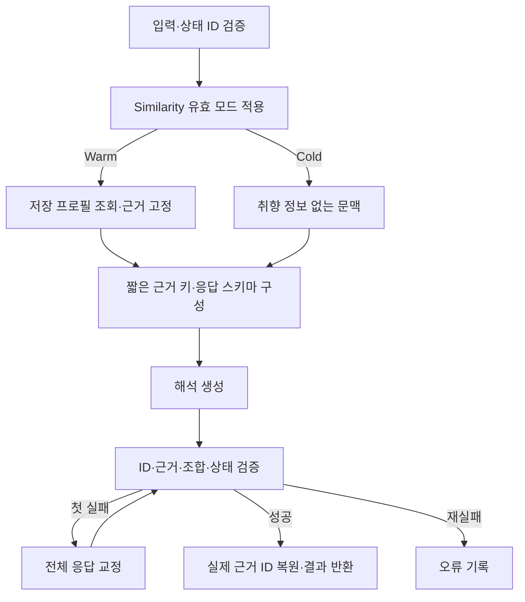

# Stylist — 요청 표현과 검색 방향 해석

현재 서비스: **v8**. [전체 구조](architecture.md) · [Search](search.md)

## 현재 연결

v8은 관계 앵커와 해석 대상의 역할을 분리한다. 인용이 실제 원문에 있는지, 해당 상태가 그 관계 해석을 담당하는지 검증하며 단순 문자열 전체 포함 여부로 정상 배정을 거절하지 않도록 현재 원본의 연결을 반영했다. 서비스의 StylistCopyV6 작업은 타임아웃을 해제하지만 유한 교정 예산은 유지한다.

## 1. 역할과 책임

Orchestrator가 배정한 미해결 표현을 상품 검색에 사용할 속성으로 해석한다. 예를 들어 착용 상황이나 정도 표현을 구체화하고, compatibility 요청에서 구매 대상의 검색 방향을 제안한다. 실제 후보와 기준 상품의 조화 점수는 Relation이, 최종 순위는 Ranking이 결정한다.

명확한 요청에는 Stylist가 생략될 수 있다. 개인화가 가능하다는 이유만으로 모든 Warm 요청에 항상 호출되는 것은 아니다.

## 2. 구조와 코드 지도

| 파일 | 역할 |
| --- | --- |
| [agents/stylist_brain.py](../src/fashion_recommendation_v2/agents/stylist_brain.py) | `StylistAgent.run`: 입력 검증, 조회·생성·교정 |
| [schemas/stylist.py](../src/fashion_recommendation_v2/schemas/stylist.py) | 입력, 해석, 상태 대응, 요청별 응답 스키마 |
| [stylist_personalization.py](../src/fashion_recommendation_v2/stylist_personalization.py) | 조회 묶음·근거 검증, 짧은 근거 키, Search 출처 투영 |
| [stylist_context.py](../src/fashion_recommendation_v2/stylist_context.py) | 기준 관찰과 해결된 해석 투영 |
| [compatibility.py](../src/fashion_recommendation_v2/compatibility.py) | 조합 안내와 앵커 근거 연결 검증 |
| [personalization_policy.py](../src/fashion_recommendation_v2/personalization_policy.py) | Similarity의 유효 Cold 모드 |
| [prompts/stylist.py](../src/fashion_recommendation_v2/prompts/stylist.py) | 일반·조합 해석 지시 |
| [agents/stylist_runner.py](../src/fashion_recommendation_v2/agents/stylist_runner.py) | Search가 Stylist 조건을 보존하는지 검사 |

## 3. 입력과 출력

| 입력 | 계약 |
| --- | --- |
| `user_request` | 비어 있지 않은 실행 요청, 필수 |
| `unresolved_states` | 하나 이상. 입력 `state_id`가 응답 허용 목록의 기준 |
| `user_id`, `personalization_mode` | 필수. 조회는 인증된 서버 어댑터로 연결 |
| `original_user_request` | 선택적 원문 |
| `relation_intent`, `anchor_evidence` | 관계 요청의 확정 의도·검증된 관찰. 관계가 있으면 기준 연결을 검사 |

현재 개인화 입력은 저장 프로필을 임의 주입하는 대신 조회 도구를 이용한다. 결과는 `interpretations`, `resolved_state_ids`, `unresolved_states`, 조합 안내와 개인화 출처 정보를 가진다.

해석마다 `attribute`, `value`, `source_text`, `state_id`, `origin`, `preference_basis`, 근거 참조를 기록한다. 순수 취향 추가는 원문 인용과 상태 ID가 `null`일 수 있지만, 사용자 미해결 상태를 해결한 해석은 실제 상태 ID에 연결되어야 한다. 값의 대안 목록은 OR이고 검색 조건은 soft다.

## 4. 실행 흐름



최초·교정은 같은 근거 키 매핑과 요청별 상태 ID 목록을 사용한다. 원래 프로필과 모델 원응답은 수정하지 않는다.

## 5. 기능별 처리 방식

**일반 해석.** 명시 상품 종류와 조건을 보존하며 상황·스타일·정도 표현을 검색 방향으로 변환한다. 옷의 디자인·마감이 아닌 배송 보장이나 알 수 없는 신체 정보는 `detail`로 우회해 채우지 않는다.

**취향 활용.** 관련 저장 해석을 먼저 사용한다. 적용 가능한 저장 해석이 없으면 검증된 원근거에서 현재 요청에 필요한 방향을 보완할 수 있다. 이 보완을 새 사용자 프로필로 자동 저장하지 않는다. category/global 범위, 긍정·부정 행동, 불확실성과 대안 설명을 함께 본다.

**출처 구분.** `preference_basis=none`은 해석 ID와 취향 근거가 없고, `profile_interpretation`은 실제 저장 해석과 그 근거를 참조하며, `raw_evidence`는 해석 ID 없이 고정 원근거를 참조한다. 존재하는 ID라는 사실뿐 아니라 해당 해석·사용자·상품·스냅샷의 소속도 검사한다.

**Compatibility.** 기준과 구매 대상을 분리하고, 확인된 앵커 사실과 일반적인 카테고리 지식을 구분한다. `compatibility_guidance`가 비개인화 제안과 평가 기준을 연결한다. 검증된 개인화 제안을 이 조합 안내에 중복 연결하지 않는다. 취향 근거가 조화의 직접 증거가 되는 것은 아니다.

**상태 해결.** 해결 표시에는 실제 해석이 있어야 한다. 해결·미해결 목록의 중복과 알 수 없는 ID를 거절하며 상태나 해석을 코드가 임의로 생성하지 않는다. 후속 Search에는 해결된 부분만 전달한다.

## 6. LLM과 코드의 역할

LLM은 표현의 의미, 적용 가능한 프로필 범위, 검색 속성, 해결 여부와 이유를 판단한다. 코드는 조회 소유권, 근거·상태 연결, 허용 속성·출처·조합 인덱스, 후속 전달을 검증한다. 코드 검증은 모델의 패션 제안이 적절하다는 품질 판정이 아니다.

## 7. 프롬프트 구성

[역할 프롬프트](../src/fashion_recommendation_v2/prompts/stylist.py)의 서비스 진입 상수는 `STYLIST_PROMPT_V6`, `STYLIST_COMPATIBILITY_PROMPT_V6`다. 요청, 입력 상태, 관계 문맥, 필요할 때 고정 프로필·근거를 전달한다. 근거 ID는 요청별 `E001` 같은 짧은 키로 보여주고 검증 후 실제 ID로 연결한다.

명시 조건 우선, 없는 신체·취향 추정 금지, 원문 인용과 상태 연결, 전체 해결 목록의 자체 점검을 지시한다. 교정에도 원래 입력과 동일 계약을 적용하며 부분 응답만 이어 붙여 통과시키지 않는다.

## 8. 정책과 종료 조건

- 해석 모델과 프로필 조회 모델은 `gpt-6-luna`다.
- 해석 생성은 최초 포함 최대 2회다. 조회는 별도로 최초 포함 최대 2회이며 [조회 정책](../src/fashion_recommendation_v2/stylist_personalization.py)의 `LOOKUP_ATTEMPTS`를 따른다.
- Cold와 similarity는 프로필 조회를 하지 않는다. Similarity는 원래 요청 모드를 보존한 채 해석 입력만 Cold로 만든다.
- Compatibility·일반 Warm은 기존 조회·반영 경로를 사용한다. 명시 사용자 조건은 취향으로 덮어쓰지 않는다.
- 해석 성공과 모든 상태 해결은 다르다. 유효한 미해결 결과를 반환한 뒤 진행 여부는 Orchestrator가 결정한다.

## 9. 실패와 복구

조회 실패는 `failed`와 시도 기록을 남기는 비개인화 fallback으로 처리한다. 정상 `not_found`와 같게 기록하지 않는다. 해석의 API·검증 실패는 한 번 교정/재시도하고 재실패하면 `StylistExecutionError`를 반환한다. 잘못된 근거 키·상태 ID를 가까운 값으로 자동 교체하지 않는다.

## 10. 실행 예제와 테스트

합성 요청 **너무 짧지 않은 크롭티 추천해줘**는 상품 종류를 유지하면서 길이 정도를 해석하는 사례다. 해석 결과의 일부를 표현하면 다음과 같다. 실제 필드와 값은 스키마·모델 판단을 따른다.

```text
입력 상태: 길이 정도를 해석해야 하는 state_id
해석: 크롭티라는 종류를 유지하는 길이 방향, soft 조건
연결: 해당 해석의 state_id → resolved_state_ids
미해결이면: unresolved_states에 유지, Search에서 제외
```

```sh
PYTHONPATH=src python -m pytest -q tests/test_service_release.py tests/test_prompt_equivalence.py tests/test_role_consolidation.py::test_schema_contracts_match_before_consolidation
```

[연결 검사](../tests/test_service_release.py), [프롬프트 검사](../tests/test_prompt_equivalence.py), [스키마 검사](../tests/test_role_consolidation.py)는 공개본의 연결·계약을 확인한다. 모든 Stylist 생성·교정 분기를 실제 LLM으로 검증하는 테스트는 아니다. Live 입력 방법은 [전체 실행 안내](architecture.md#로컬-실행과-합성-예제)를 따른다.

## 11. 설계 이유와 한계

해석과 추천 순위를 분리하고 검색 조건에 출처를 남겨, 어떤 제안이 사용자 요청인지 취향 보완인지 추적한다. 짧은 ID는 참조 오류를 줄이는 표현 장치이며 검증을 대신하지 않는다. 모호한 표현·카테고리 지식·취향의 인과 해석은 여전히 모델 품질에 의존한다.
