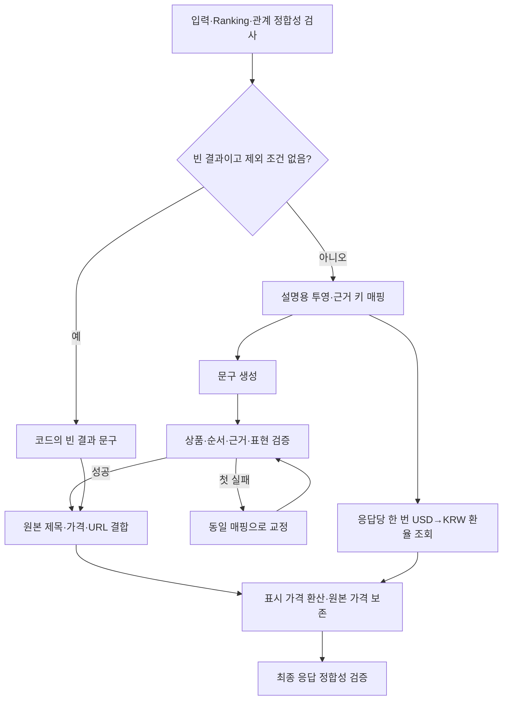

# Summary — 확정 추천을 사용자 응답으로 변환

현재 서비스: **v13**. [전체 구조](architecture.md) · [Ranking](ranking.md)

## 1. 역할과 책임

확정된 상품·순위와 검증된 요청·관계·취향 근거를 한국어 설명으로 바꾼다. 상품을 추가·대체·재정렬하거나 조건을 다시 해석하지 않는다. 검색·이미지 재분석·관계 평가는 수행하지 않는다. USD 상품의 표시용 원화 환산은 코드가 수행한다. 정상 추천, 일부 조건 미반영, 추천 개수 부족, 요청 중단을 서로 구분해 안내한다.

## 2. 구조와 코드 지도

| 파일 | 역할 |
| --- | --- |
| [agents/summary.py](../src/fashion_recommendation_v2/agents/summary.py) | `SummaryAgent.run`, `_generate`, `run_blocked`, `run_blocked_fallback` |
| [schemas/summary.py](../src/fashion_recommendation_v2/schemas/summary.py) | 입력, 모델 문구, 사용자 응답·참조 검증 |
| [schemas/summary_response.py](../src/fashion_recommendation_v2/schemas/summary_response.py) | 서비스 저장·복원 시 응답 파싱 경계 |
| [summary/evidence_references.py](../src/fashion_recommendation_v2/summary/evidence_references.py) | 요청별 짧은 근거 키와 실제 ID 연결 |
| [summary/personalization_v9.py](../src/fashion_recommendation_v2/summary/personalization_v9.py) | 현재 서비스가 사용하는 Ranking 개인화 상태 투영 |
| [summary/summary_policy.py](../src/fashion_recommendation_v2/summary/summary_policy.py) | 서비스 모델 정책 |
| [prompts/summary.py](../src/fashion_recommendation_v2/prompts/summary.py) | `SUMMARY_PROMPT`, 중단 안내 지시 |

## 3. 입력과 출력

`SummaryAgentInput`은 `user_request`, `candidate_set`, `final_ranking`을 기본으로 받는다. `ralationRatio`는 관계 결과가 있을 때, `omitted_conditions`는 검색 전에 제외한 조건이 있을 때 사용한다. `omitted_conditions`의 기본값은 빈 목록, 관계 결과는 null이다. `interaction_collection_enabled`, `profile_updates_enabled`의 스키마 기본값은 false이며 서비스가 실제 기능 상태를 전달한다. 이 값은 코드 안내의 근거다.

| 출력 | 내용과 소유자 |
| --- | --- |
| `intro` | 실제 추천 개수·요청 방향, LLM |
| `remarks` | 조건 미반영·부족·충돌·확인 사항, LLM |
| `recommendations` | 확정 item_id/rank와 추천 이유·주요 특징·취향 근거 참조 |
| `outro`, `next_recommendation` | 마무리·허용된 후속 제안, LLM/검증 |
| `title`, `price`, `item_web_url`, `image_url` | 후보 원본에서 코드가 결합 |
| `response_id`, `feedback_notice` | 코드가 생성·기능 상태에 따라 구성 |

모델용 `RecommendationCopy`와 실제 카드 정보를 포함한 `RecommendationResponse`를 분리한다. 모델이 상품 URL이나 가격을 새로 작성하게 하지 않는다. 중단 응답은 별도 `BlockedSummaryInput → BlockedResponse` 계약이다.

## 4. 실행 흐름



재실패하면 실행 오류를 반환한다. 빈 결과라도 `omitted_conditions`가 있으면 미반영 사실을 설명해야 하므로 일반 생성 경로를 사용한다.

## 5. 기능별 처리 방식

**입력 축소.** 최종 선정 상품에 필요한 요청·Search·Relation·취향 근거를 투영한다. 프로필 전체나 기존 점수를 바탕으로 새로운 취향 판단을 하게 하지 않는다. Search의 관찰은 텍스트 근거로 사용하며 원본 판매 정보와 충돌하는 사실을 덧붙이지 않는다.

**짧은 근거 키.** Ranking이 실제 사용한 근거 ID만 정렬해 E001 같은 키를 만든다. 같은 ID는 같은 키를 사용하되 상품별 인용 허용 집합은 따로 둔다. 모델 응답의 키를 확인한 후 실제 ID로 복원하고 다시 검증한다. 다른 상품의 전용 근거나 프로필에만 있는 미사용 근거를 인용할 수 없다.

**취향 설명.** `personalization_context`의 실제 적용 상태와 선택 유형을 사용한다. P=0은 활성 상태일 수 있으므로 긍정적 적합성으로 바꾸지 않는다. 개인화·비개인화 보충이 섞이면 실제 상품별 상태를 구분하고 미적용 상품에 취향 근거를 만들어 붙이지 않는다.

**미반영과 부족.** `omitted_conditions.source_text`를 정확히 인용해 해당 조건이 검색 전에 제외되었음을 설명한다. 내부 `reason`을 사용자에게 그대로 나열하지 않는다. 요청 5개 중 3개만 반환한 개수 부족은 별도로 설명한다. 검색에서 제외된 조건을 실제 상품이 충족했거나 위반했다고 말하지 않는다.

**카드와 기능 안내.** 제목·가격·URL은 코드가 CandidateSet에서 가져온다. 좋아요 수집과 프로필 갱신 가능 여부는 `feedback_notice`로 안내한다. 모델이 이벤트가 이미 저장되었거나 즉시 개인화가 완료된 것처럼 약속하지 않는다.

## 6. LLM과 코드의 역할

LLM은 근거 범위 안에서 자연스러운 해요체 문장을 만든다. 코드는 상품 ID·순서·개수, 취향 근거 소속, 후속 제안·공지 계약과 원본 카드 정보를 검사한다. 사용자 문구의 사실성·자연스러움을 모든 경우에 결정적으로 증명할 수는 없다.

## 7. 프롬프트 구성

[SUMMARY_PROMPT](../src/fashion_recommendation_v2/prompts/summary.py)는 확정 순위 보존, 조건 판정과 불확실성 유지, 판매자 주장과 관찰의 구분, 요청 밖의 소재·보온성·배송·재고 추정 금지를 지시한다. 생성·교정에 같은 의미 규칙을 적용한다.

현재 개인화 안내는 Ranking에서 전달된 적용 상태·근거 범위에서 작성한다. 단일 행동을 평소의 확정 취향으로 일반화하지 않는다. 에이전트명·내부 ID·점수·무관한 사용자 행동 이력은 사용자 문구에 노출하지 않도록 지시한다. 교정은 실패 진단을 받은 전체 응답을 다시 생성한다.

## 8. 정책과 종료 조건

- 서비스 모델은 `gpt-6-luna`, reasoning은 API 기본 설정이다.
- 일반 문구 생성은 최초 포함 최대 2회다. API 오류와 검증 오류 모두 같은 유한 시도 한도 안에서 처리한다.
- 중단 설명은 기본 최대 2회이며 Orchestrator가 필요할 때 별도 마지막 fallback 1회를 호출한다. 재귀적으로 반복하지 않는다.
- 빈 결과·제외 조건 없음 경로는 코드 문구를 사용하므로 일반 추천 설명 LLM 호출을 하지 않는다.
- 상품이 있으면 `next_recommendation`은 서로 다른 짧은 한국어 요청문 2개, 없으면 빈 배열이다. 상품별 `key_features`는 근거 있는 특징 0~2개이며 억지로 채우지 않는다.
- v13의 환율 조회는 문구 생성과 병렬이다. USD 추천이 없으면 조회하지 않는다. 조회 실패 시 원래 USD 가격을 보존하며 환율 오류를 기록한다.
- v11의 검증 재사용 활성화가 v13에도 자동 적용된다고 가정하지 않는다. 현재 버전의 입력·응답 검증 경로를 따른다.

## 9. 실패와 복구

알 수 없는 키, 다른 상품 근거, 누락·중복 ID, 변경된 순위나 유효하지 않은 출력은 교정 대상으로 기록한다. 긴 ID를 유사한 짧은 키로 자동 보정하지 않는다. 시도별 원문·원응답·매핑·검증을 남기며 성공한 경우에만 파생 결과를 만든다.

재실패는 `SummaryExecutionError`이며 Ranking의 성공을 사용자 응답 성공으로 간주하지 않는다. 중단 안내까지 실패하면 원래 중단 사유와 안내 실패를 모두 보존한다.

## 10. 실행 예제와 테스트

가상의 5개 요청에 3개가 선정되고 한 조건이 사전 제외되었다면 확인할 출력은 다음과 같다.

```text
intro: 실제 추천 3개와 반영한 요청 방향
remarks: 제외 조건의 정확한 원문·미반영 사실, 개수 부족·중요 한계
recommendations: Ranking의 3개 item_id/rank 그대로
feedback_notice: 실제 기능 연결 상태에 맞는 코드 안내
```

이는 문구 내용의 설명 예시이며 특정 모델의 출력 문자열을 보장하지 않는다.

```sh
PYTHONPATH=src python -m pytest -q tests/test_summary_schema.py tests/test_prompt_equivalence.py tests/test_role_consolidation.py::test_schema_contracts_match_before_consolidation
```

[응답 스키마 테스트](../tests/test_summary_schema.py)는 참조·응답 계약의 대표 사례, [프롬프트 검사](../tests/test_prompt_equivalence.py)는 현재 연결 문자열, [스키마 검사](../tests/test_role_consolidation.py)는 통합 전후 계약을 검증한다. 공개된 스키마 테스트에는 공통 계약 사례도 포함되며 Summary의 모든 생성·교정 의미 분기를 포괄하지 않는다. 실제 응답은 [로컬 실행](architecture.md#로컬-실행과-합성-예제)으로 확인한다.

## 11. 설계 이유와 한계

후보 선정과 설명 생성을 분리해 자연어 생성이 추천 결과를 바꾸지 못하게 한다. 카드 필드와 근거 ID의 코드 결합은 환각 가능성을 줄이지만 문장의 과장·잘못된 함의까지 모두 차단하지는 않는다. 부분 조건 안내·취향 해석의 적절성은 사람 검토가 필요하다.
